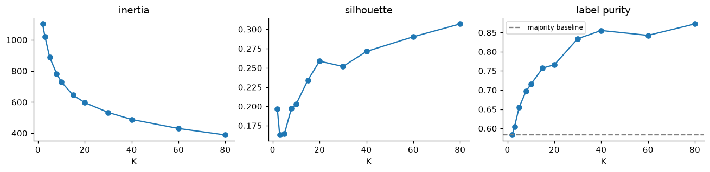
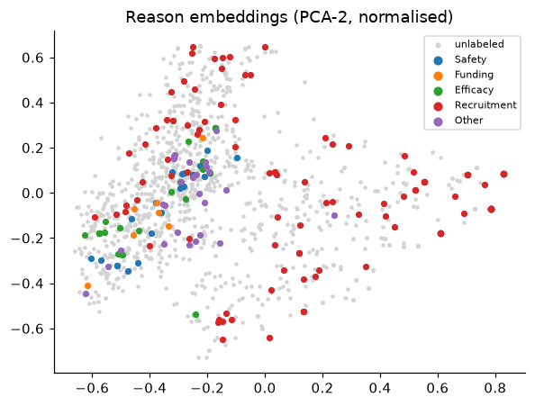
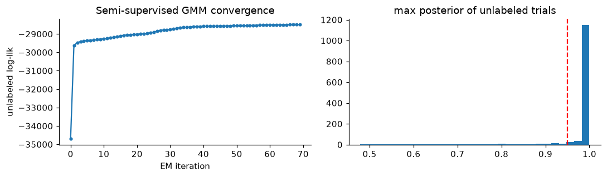
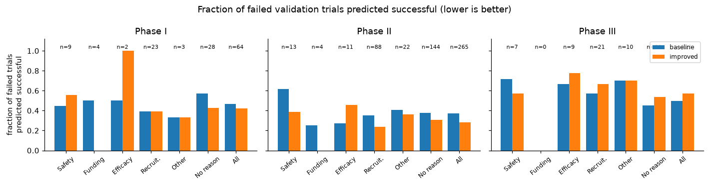

# Labeling Stopping Reasons and Predicting Outcomes of Clinical Trials

**Course:** CS5785 / ORIE5750 / ECE5414, Fall 2026, Midterm Project

**Group members and contributions:**

| Name | Contribution |
|---|---|
| [TBD] | [TBD] |
| [TBD] | [TBD] |

---

## Abstract

Part 1 asks for five stopping-reason labels on 1,171 terminated trials, only 157 of them labeled. K-means diagnostics show weak cluster structure in the reason embeddings (silhouette 0.16–0.31, adjusted Rand index with the true label-sets at most 0.20). We compared nine labeling approaches, from cluster voting to a semi-supervised GMM, self-training and label spreading. The selected model averages a supervised logistic regression (LR) with two pseudo-label models and raises validation sample-F1 from 0.865 to 0.897 and macro-F1 from 0.707 to 0.806. Most of the macro-F1 gain comes from Funding, which has 8 labeled positives. Part 2 predicts whether a trial met its primary endpoint in each phase. The starter model's log loss of 0.940 is worse than predicting each phase's success rate, because its probabilities are poorly calibrated. One regularized LR on field-wise TF-IDF features, shared across phases by feature augmentation, lowers mean validation log loss to 0.567 and raises ROC-AUC from 0.690 to 0.761. A split by start year suggests that temporal drift costs about 0.07 AUC and leaves log loss almost unchanged.

## 1 Methods

### 1.1 Data and constraints

Both parts come from the HINT benchmark [1] and ClinicalTrials.gov [2]. In Part 1, the 312 latest trials (2010–2016) form the test set and the remaining 1,249 are split at random into train (1,171) and validation (78). Only 157 train trials are labeled: the earliest 117 plus 40 chosen for rare reasons. Recruitment covers 64.3% of them and Funding 5.1% (8 positives); 147 have exactly one reason. The input is a 150-dimensional reason embedding (a PCA-reduced, randomly rotated sentence embedding). In Part 2 each row is one trial in one phase. Train (8,037 rows) and validation (1,013) hold trials that started in 2013 or earlier, split by trial; the 1,500 test rows come from 2013–2022. Train success rates are 0.566, 0.477 and 0.653 for phases I, II and III.

Reason embeddings and labels are used in Part 2 only for the error analysis, never as classifier inputs. Trial IDs are used only to match the two parts, and no deep learning is used. The Part 1 semi-supervised methods include the unlabeled test embeddings in the unlabeled pool, which makes the setting transductive; no test labels are used. Validation trials and CV hold-out folds are never in the pool.

### 1.2 Part 1: recovering reason labels

**Shared components.** Embeddings are standardized with train-file statistics. The unlabeled pool $X_U$ holds the 1,014 masked train trials and the 312 test trials. Each reason gets an L2-regularized LR with `class_weight="balanced"`. Pseudo-labels are down-weighted by `sample_weight`; scikit-learn multiplies the two weights, so a rare-class pseudo-label ends up with more weight than $w_u$. Every trial has at least one reason and an empty prediction scores 0, so all methods keep labels with probability $\ge0.5$ and fall back to the most probable label when none passes.

**Evaluation.** One of the 78 validation trials moves sample-F1 by about 1.3 points, so we also report 2×5-fold cross-validation (CV) on the 235 labeled trials (157 train plus 78 validation), with hold-out labels hidden.

**Cluster diagnostics.** All 1,561 trials are L2-normalized and reduced to 50 principal components. K-means is run for $K$ from 2 to 80, recording inertia, silhouette, the label-set purity of labeled trials, and the ARI [11] between clusters and label-sets.

**Labeling methods.** Nine families, tuned on validation and CV:

- **A, supervised LR** on the 157 labeled trials, $C\in\{0.01,0.1,1,10\}$.
- **B0 / B, K-means cluster-then-label.** K-means on L2-normalized PCA-50 features, centroids initialized with k-means++ [6], 10 restarts keeping the lowest inertia. Cluster label vectors are smoothed toward the labeled prior $\bar y$: $\hat y_k=(\sum_{i\in L,c_i=k}y_i+\bar y)/(n_k+1)$. B0 predicts $\hat y_k$; B uses it as a pseudo-label with weight $w_u\in\{0.3,1\}$ and retrains LR. $K\in\{10,20,40,80\}$.
- **C, K-means ∩ LR agreement.** Unlabeled trials where cluster voting and the supervised LR agree on all five labels get the LR labels as pseudo-labels ($w_u=1$). As in co-training, the two models make different kinds of errors. $K\in\{10,20,40\}$.
- **D, GMM soft labels.** Diagonal-covariance GMM on PCA-20, `reg_covar=1e-3`, 3 restarts, components initialized from K-means (scikit-learn default). Each unlabeled trial gets a posterior-weighted soft label $p$ and enters LR as a $y=1$ row with weight $w_up$ and a $y=0$ row with weight $w_u(1-p)$, $w_u=0.5$.
- **E0 / E, semi-supervised GMM** following Nigam et al. [3]. One Gaussian component per label-set observed in the labeled data: 7 label-sets, so $K=7$ (Funding's 8 positives fall into three of them). Components share one covariance with a ridge of $10^{-2}I$, since 157 trials cannot support per-component covariances. EM runs in a $d$-dimensional PCA space. *Initialization:* the first M-step uses the labeled one-hot responsibilities only, with no random or K-means start. Labeled responsibilities stay fixed. *E-step:* $r_{ik}\propto\pi_k\mathcal N(z_i\mid\mu_k,\Sigma)$ for unlabeled trials. *M-step:* unlabeled responsibilities are weighted by $\lambda$, so $\lambda=0$ is a purely supervised generative classifier. *Convergence:* relative change in unlabeled log-likelihood below $10^{-5}$, at most 100 iterations. Predictions are $P(y_j=1\mid z)=\sum_kp(k\mid z)c_{kj}$, with $c_k$ the label-set of component $k$. E0 uses this posterior directly ($d\in\{10,20,40\}$, $\lambda\in\{0,0.3,1\}$). E keeps unlabeled trials with maximum posterior above 0.8 or 0.95 and uses their MAP label-set as a pseudo-label ($w_u=0.3$).
- **F, self-training LR.** Up to 5 rounds; a trial joins when all five probabilities satisfy $|2p_j-1|\ge0.8$ or $0.95$.
- **G, label spreading** [10] on a kNN graph ($k\in\{10,20\}$, $\alpha=0.5$), per reason.
- **H, ensemble:** the mean probability of A ($C=0.1$), C ($K=20$) and E ($d=20$, threshold 0.95), one discriminative model and two pseudo-label models of different kinds.

**Features.** On the supervised LR we added, one at a time, `start_year`; TF-IDF of `criteria`, `diseases_cleaned` and `drugs` reduced to 50 dimensions by SVD; a matched-drug flag with multi-hot drug actions; multi-hot level-0 Reactome pathways [9]; and all of these. `pathway_level` describes the pathway, not the drug, so it was used only to select top-level pathways. The chosen model is refit on all 235 labeled trials.

### 1.3 Part 2: predicting trial outcomes

**Baseline.** One LR per phase on a binary bag of words over the four text fields ($C=1$, up to 20,000 features).

**Representations and classifiers.** Bag of words, TF-IDF on unigrams, and TF-IDF on 1–2-grams, each with LR ($C$ from 0.01 to 10), Multinomial NB on counts or TF-IDF ($\alpha$ from 0.1 to 10), or distance-weighted cosine kNN ($k\in\{25,75,150\}$).

**Field-wise TF-IDF.** In one concatenated string, the long `criteria` field outweighs `drugs` and `icdcodes`. We fit one TF-IDF per field and concatenate them with fixed weights (1.0 for `criteria`, 0.5 for the others). Each ICD code is preceded by its three-character category (`E11.65` becomes `E11 E11.65`) [12], so related codes share a feature. Optional blocks add drug-knowledge tokens (targets and actions prefixed with `TGT_` and `ACT_`) and RDKit [7] Morgan fingerprints [8] (radius 2, 1,024 bits, bitwise maximum over a trial's drugs, rows scaled by the square root of the number of set bits).

**Pooled LR.** The project allows a model that uses the phase. We use the feature augmentation of Daumé III [4], with each phase as a domain:
$$\phi(x,p)=[\,x,\ \mathbb 1[p=\mathrm I]x,\ \mathbb 1[p=\mathrm{II}]x,\ \mathbb 1[p=\mathrm{III}]x,\ e_p\,].$$
Phase $p$ has effective weights $w_0+w_p$ and its own intercept from $e_p$. L2 regularization shrinks $w_p$ toward 0, so phases share strength. One LR is fit on all rows, $C\in\{0.3,1,3\}$. We also averaged it with a per-phase TF-IDF LR, kNN or MNB.

**Error analysis.** Failed validation trials are matched by `trial_id` to Part 1 IDs and take the true or predicted reasons; unmatched trials form a "no recorded reason" group, and a trial can count toward several reasons. Each phase is analyzed separately (we assert unique `trial_id` within a phase). For each group we report its size, how many reasons are true or predicted labels, and the fraction predicted successful, which is the group's false positive rate (FPR).

**Trade-offs and drift.** We tested thresholds from 0.4 to 0.7, `class_weight="balanced"`, shrinkage toward the phase success rate $\pi$, $p'=\pi+s(p-\pi)$ with $s\in\{1,0.9,0.8,0.7\}$, and clipping to $[0.02,0.98]$, which caps the cost of a confident mistake at $-\ln0.02\approx3.9$. As a proxy for the later test years, we train on trials from 2008 or earlier (6,326 rows) and evaluate on 2010 or later (2,290 rows). The final model is refit on train ∪ validation (9,050 rows). All models use scikit-learn [5], and every figure is produced by code in the submitted notebook.

## 2 Results

### 2.1 Part 1

**Cluster diagnostics** (Figure 1). Inertia falls smoothly with no elbow. Silhouette is lowest at $K=3$ (0.163) and rises to 0.307 at $K=80$ without a peak. Purity rises from 0.583 to 0.872, but 0.583 at $K=2$ is exactly the purity of predicting Recruitment for every trial. ARI peaks at $K=5$ (0.203) and falls to 0.076 at $K=80$. Larger $K$ therefore produces smaller pieces, not partitions closer to the reasons. In the PCA projection (Figure 2), the four minority reasons overlap in one region while Recruitment spreads over the whole plot.

*Figure 1. K-means on all 1,561 trials: inertia, silhouette and label-set purity. Dashed line: purity of predicting Recruitment for every trial (0.583).*

*Figure 2. PCA of the L2-normalized reason embeddings. Colored points are single-reason labeled trials; all others are grey.*

**Method comparison.** Table 1 lists one configuration per family; all 40 are in the notebook. The supervised LR is insensitive to $C$ (validation sample-F1 0.859–0.872). B improves with $K$ (0.801 at $K=10$ to 0.844 at $K=80$), and B0 gets Funding F1 = 0 at $K=10$ and 20. E0 gets worse as $\lambda$ grows: for $d=10$, validation sample-F1 falls from 0.868 to 0.724 and CV from 0.845 to 0.806 as $\lambda$ goes from 0 to 1. Raising E's threshold from 0.8 to 0.95 changes validation sample-F1 only from 0.838 to 0.844. F at threshold 0.8 reaches 0.895 / 0.769, close to the best C configuration (0.893 / 0.785 at $K=10$). With $d=20$ and $\lambda=1$, EM converges after 70 iterations, and 91.1% of unlabeled trials then have a maximum posterior of at least 0.95 (Figure 3).

| Method | val s-F1 | val m-F1 | CV s-F1 | CV m-F1 |
|---|---|---|---|---|
| Baseline (starter code) | 0.8654 | 0.7067 | – | – |
| A supervised LR ($C=0.1$) | 0.8590 | 0.7291 | **0.8957** | **0.7979** |
| B0 K-means vote ($K=40$) | 0.8462 | 0.6844 | 0.8195 | 0.6469 |
| B K-means pseudo ($K=40$, $w_u=0.3$) | 0.8162 | 0.6963 | 0.8579 | 0.7347 |
| C K-means ∩ LR ($K=20$) | 0.8761 | 0.7709 | 0.8818 | 0.7688 |
| D GMM soft labels ($K=20$) | 0.7744 | 0.6174 | 0.7924 | 0.6305 |
| E ss-GMM pseudo ($d=20$, 0.95) | 0.8440 | 0.6936 | 0.8630 | 0.7074 |
| F self-training (0.95) | 0.8654 | 0.7578 | 0.8818 | 0.7817 |
| G label spreading ($k=20$) | 0.6923 | 0.4816 | 0.8319 | 0.5843 |
| **H ensemble (A+C+E)** | **0.8974** | **0.8058** | 0.8900 | 0.7714 |

*Table 1. Part 1 validation and 2×5-fold CV results. s-F1: sample-wise F1; m-F1: macro-F1.*

*Figure 3. Semi-supervised GMM: unlabeled log-likelihood per EM iteration (left) and maximum posterior of unlabeled trials after convergence (right, red line at 0.95).*

**Selected model and features.** H raises macro-F1 by 0.099, and Funding alone gains 0.464 (Table 2). Among feature groups (Table 3), only text SVD helps, by 0.013 or about one validation trial, and adding all groups scores below text alone, so the final model uses the embeddings only. Without year information, H predicts Safety for 0.183 of test trials against 0.102 in the labeled set, and Recruitment for 0.580 against 0.643.

| | Safety | Funding | Efficacy | Recruit. | Other | s-F1 | m-F1 |
|---|---|---|---|---|---|---|---|
| Baseline | 0.857 | 0.286 | 0.828 | 0.980 | 0.583 | 0.865 | 0.707 |
| H | 0.889 | 0.750 | 0.800 | 0.990 | 0.600 | 0.897 | 0.806 |

*Table 2. Per-label validation F1.*

| Feature set | Dim. | val s-F1 | val m-F1 |
|---|---|---|---|
| Embedding only (used) | 150 | 0.8590 | 0.7291 |
| + `start_year` | 151 | 0.8526 | 0.7462 |
| + text TF-IDF → SVD-50 | 200 | 0.8718 | 0.7533 |
| + drug match and actions | 180 | 0.8632 | 0.7335 |
| + level-0 pathways | 179 | 0.8632 | 0.7453 |
| + all | 260 | 0.8611 | 0.7492 |

*Table 3. Feature groups added to the supervised LR ($C=0.1$).*

### 2.2 Part 2

The selected model is the pooled field-wise TF-IDF LR with $C=1$. It improves every metric in every phase (Table 4), and mean log loss falls from 0.940 to 0.567. Table 5 lists representative configurations.

| Phase | F1 | ROC-AUC | PR-AUC | Log loss |
|---|---|---|---|---|
| I | 0.701 → 0.727 | 0.703 → 0.759 | 0.754 → 0.799 | 0.879 → 0.585 |
| II | 0.614 → 0.645 | 0.663 → 0.737 | 0.638 → 0.718 | 1.060 → 0.599 |
| III | 0.774 → 0.815 | 0.705 → 0.789 | 0.815 → 0.878 | 0.881 → 0.516 |
| Mean | 0.696 → 0.729 | 0.690 → 0.761 | 0.736 → 0.798 | 0.940 → 0.567 |

*Table 4. Validation results per phase, baseline → selected model.*

| Model (mean over phases) | F1 | AUC | PR-AUC | LL |
|---|---|---|---|---|
| Ens. pooled + per-phase TF-IDF LR | 0.725 | 0.765 | 0.802 | 0.564 |
| Ens. pooled + kNN | 0.727 | 0.765 | 0.806 | 0.565 |
| **Pooled field-wise LR (selected)** | 0.729 | 0.761 | 0.798 | 0.567 |
| TF-IDF 1–2gram LR | 0.723 | 0.757 | 0.795 | 0.570 |
| Field-wise LR + Morgan | 0.718 | 0.753 | 0.798 | 0.575 |
| Field-wise LR | 0.722 | 0.755 | 0.799 | 0.576 |
| Field-wise LR + pathway/target/action | 0.715 | 0.753 | 0.798 | 0.576 |
| Field-wise LR + `start_year` | 0.730 | 0.749 | 0.793 | 0.578 |
| BoW LR, $C=0.01$ | 0.733 | 0.737 | 0.779 | 0.592 |
| kNN, TF-IDF, $k=75$ | 0.718 | 0.734 | 0.779 | 0.598 |
| MNB, TF-IDF, $\alpha=1$ | 0.718 | 0.724 | 0.778 | 0.652 |
| Baseline: BoW LR, $C=1$ | 0.696 | 0.690 | 0.736 | 0.940 |
| MNB, counts, $\alpha=1$ | 0.701 | 0.714 | 0.737 | 3.651 |

*Table 5. Part 2 validation results, sorted by log loss (LL).*

**Error analysis** (Table 6, Figure 4). The no-recorded-reason group holds 44%, 54% and 67% of failed trials in phases I, II and III.

| Group | I: n | t/p | base | impr. | II: n | t/p | base | impr. | III: n | t/p | base | impr. |
|---|---|---|---|---|---|---|---|---|---|---|---|---|
| Safety | 9 | 1/8 | .444 | .556 | 13 | 1/12 | .615 | .385 | 7 | 1/6 | .714 | .571 |
| Funding | 4 | 1/3 | .500 | .000 | 4 | 1/3 | .250 | .000 | 0 | – | – | – |
| Efficacy | 2 | 0/2 | .500 | 1.00 | 11 | 0/11 | .273 | .455 | 9 | 0/9 | .667 | .778 |
| Recruitment | 23 | 2/21 | .391 | .391 | 88 | 12/76 | .352 | .239 | 21 | 5/16 | .571 | .667 |
| Other | 3 | 0/3 | .333 | .333 | 22 | 3/19 | .409 | .364 | 10 | 2/8 | .700 | .700 |
| No recorded reason | 28 | – | .571 | .429 | 144 | – | .375 | .306 | 82 | – | .451 | .537 |
| All failed | 64 | | .469 | .422 | 265 | | .370 | .283 | 123 | | .496 | .569 |

*Table 6. FPR of failed validation trials by reason group. t/p: trials whose reason is a true label / a Part 1 prediction.*

*Figure 4. FPR by reason group, baseline vs. improved model. Phase III has no Funding trials. The phase III legend hides two sizes: no recorded reason n = 82, all failed n = 123.*

**Trade-offs and drift.** Raising the threshold from 0.5 to 0.7 cuts the phase II FPR from 0.283 to 0.083 but its F1 from 0.645 to 0.504 (Table 7). `class_weight="balanced"` moves mean AUC from 0.7612 to 0.7609 and log loss from 0.5665 to 0.5685, with slightly lower F1 in every phase. Shrinkage is best at $s=1$ on both splits (temporal log loss 0.5672, 0.5683, 0.5717, 0.5772 for $s=1$ to 0.7). Test predictions lie in $[0.080,0.979]$, so clipping changes almost nothing. On the temporal split, the pooled LR's AUC falls from 0.761 to 0.695 with log loss 0.567 in both cases, while the baseline goes from 0.690 to 0.617 AUC and from 0.940 to 1.018 log loss. Later trials succeed more often (0.655 against 0.522).

| Thr. | F1 I / II / III | FPR I / II / III | TPR I / II / III |
|---|---|---|---|
| 0.4 | .776 / .664 / .825 | .547 / .460 / .667 | .894 / .754 / .942 |
| **0.5** | .727 / .645 / .815 | .422 / .283 / .569 | .753 / .627 / .888 |
| 0.6 | .693 / .608 / .800 | .234 / .128 / .415 | .624 / .500 / .808 |
| 0.7 | .585 / .504 / .756 | .109 / .083 / .244 | .447 / .369 / .683 |

*Table 7. Selected model at different thresholds (0.5 used).*

## 3 Discussion

### 3.1 Part 1

**Reasons do not form clusters.** Low silhouette, no peak and an ARI of at most 0.20 mean that K-means clusters only partly match the reasons, and Figure 2 suggests the only split available is Recruitment against the rest. Methods that rely on cluster structure alone do worst: B0, D and G reach validation macro-F1 of 0.684, 0.617 and 0.482, all below the supervised LR. The 8 labeled Funding trials sit in clusters dominated by Recruitment, so no smoothed cluster vector gives Funding a share of 0.5. Because sample-F1 is dominated by Recruitment, the one class clustering roughly separates, these methods lose little sample-F1 but a lot of macro-F1. Our reading is that sentence embeddings capture wording: "stopped for safety concerns" and "stopped for lack of efficacy" are phrased alike, while recruitment problems are described in many ways.

**Pseudo-labels help only after filtering.** Unfiltered B (0.816 validation, 0.858 CV) is below A (0.859, 0.896). The 1,326 unlabeled trials outnumber labeled ones 8 to 1, so noisy pseudo-labels dominate the loss even at weight 0.3. C and F filter by agreement or confidence and both beat A on validation. The trials they keep lie far from the decision boundary and cover regions the 157 early labeled trials miss, which acts mostly as regularization. F matches C without clustering, so the gain comes from filtering; clustering contributes to C as a second, independent opinion, not as a description of reason structure.

**The semi-supervised GMM converges but is confidently wrong.** EM converges and 91.1% of posteriors exceed 0.95, yet the model trails the supervised LR, and in CV its score falls monotonically with $\lambda$ for every $d$ (0.886, 0.865, 0.829 for $d=40$). Nigam et al. [3] showed that with a misspecified generative model, EM moves the parameters toward higher likelihood and worse classification. Our model assumes one Gaussian per label-set with a shared covariance, but Recruitment is broad and the minority classes are compact (Figure 2), and the Funding-only component has 4 trials to estimate its mean. A high posterior then measures the model's certainty, not its accuracy, which is why a stricter threshold barely helps.

**Validation and CV disagree.** H is best on validation but trails A in CV: 0.890 vs. 0.896 sample-F1 (within noise) and 0.771 vs. 0.798 macro-F1. We keep H because the project selects on validation, and because its gain is on rare classes: its Funding F1 of 0.750 is the best of all 40 configurations and its Other F1 of 0.600 is above A's 0.455. Averaging three differently biased models reduces the variance of rare-class predictions. CV folds also train on about 188 trials, fewer than the final 235, which makes the pseudo-label filters less stable. Still, 78 validation trials cannot separate A, C and H statistically.

**Feature selection.** The extra features describe trial design, while the stopping-reason text is already in the embedding. With 157 labels, 29–110 extra dimensions mostly add variance; the best gain (0.013) is one validation trial, and adding everything is worse than text alone, so the groups add noise without complementary signal. We excluded `start_year` for another reason: labeled trials are early and test trials late, and the project notes that Recruitment is more common early and Safety later, so a year feature would teach a rule that fails on the test set. The predicted shift toward Safety and away from Recruitment on the test set, obtained without the year, points in the expected direction. Funding is predicted less often than in the labeled set (0.032 vs. 0.051 on test), consistent with the 40 extra labeled trials having been chosen for rare reasons.

### 3.2 Part 2

**Calibration, not ranking, was the baseline's problem.** Predicting each phase's success rate gives a log loss of about 0.67. With 20,000 features, 1,012–3,950 rows per phase and $C=1$, the training data are nearly separable and the baseline's probabilities are pushed toward 0 and 1. Changing $C$ to 0.01 alone lowers log loss to 0.592, while AUC only moves from 0.690 to 0.737.

**The metric decides which models look good.** MNB on counts has ordinary AUC (0.714) and F1 (0.701) but a log loss of 3.65. We attribute this to the independence assumption: correlated words in `criteria` are counted as independent evidence and push posteriors to the extremes. On TF-IDF its log loss falls to 0.65–0.72, and a larger $\alpha$ lowers it further at a small AUC cost. kNN probabilities are bounded vote shares, so its log loss stays moderate, but its ranking trails LR. TF-IDF with bigrams beats unigrams, which beat bag of words.

**Pooling helps phases II and III.** Against per-phase field-wise LRs, the pooled model raises AUC by 0.012 in phase II and 0.013 in phase III and lowers it by 0.005 in phase I, the phase with the least data. We suspect phase I endpoints, mostly about safety and dosing, differ from the efficacy endpoints of later phases, while phases II and III define success similarly. The gain therefore seems to come from transfer between similar phases, not from sample size.

**Domain-knowledge features add nothing.** Pathways, targets, fingerprints and `start_year` each change log loss by less than 0.003 and lower AUC slightly. Only 45.7% of train rows have a matched drug, since biologics are mostly unmatched. Drug biology also says little about design choices such as the endpoint, eligibility and power, and drug names are already in the text. As in Part 1, features describing the trial design add little information. The best ensemble improves log loss by only 0.0026, which 1,013 validation rows cannot resolve, so we kept the single model.

**Error rates by reason group.** Two limits apply. Small groups are noisy: with $n=4$ one trial moves the rate by 0.25, so the Funding drop to 0 means nothing, and we interpret only groups with $n\ge10$. Most reasons are also Part 1 predictions (only 12 of 88 phase II Recruitment trials are true labels), and their reliability differs by class: Part 1 validation F1 is 0.99 for Recruitment but 0.75 for Funding and 0.60 for Other, so the smallest groups are also the least reliably assigned. Among larger groups, the no-recorded-reason trials ran to completion and read like successful ones; the baseline's FPR on them in phase I is 0.571. The clearest gain is phase II Recruitment (0.352 to 0.239, $n=88$). One possible explanation, which we did not test, is that trials that later struggle to recruit have narrow eligibility criteria that bigram features can detect. Phase III Safety and Efficacy stay at 0.57–0.78 under both models, but with $n<10$ this is only a tendency; confirmatory trials may fail because of how the drug performs, which the text does not show.

**Higher FPR in phase III.** The phase III FPR rises from 0.496 to 0.569 while every other metric improves. With a success rate of 0.653, the better calibrated model predicts success more often, which raises recall on successes and FPR on failures. A threshold of 0.6–0.7 suits screening out likely failures; 0.5 suits calibrated probabilities as scored on Kaggle. Class weighting only moves the boundary and worsens calibration, since the classes are already close to balanced (0.477–0.653), and the best shrinkage of $s=1$ suggests the regularized LR is already well calibrated.

**From validation to test.** The temporal split lowers AUC by about 0.07 for both models, so we expect test AUC around 0.07 below validation, from new drugs, therapies, wording and indications. The pooled LR keeps its log loss because later trials succeed more often and the phase intercepts partly absorb this, offsetting the weaker ranking. The baseline's extreme probabilities turn into more costly mistakes. Test trials (2013–2022) are further from the training years than this proxy, so the real drop may be larger.

**Limitations.** HINT labels remain somewhat noisy after the 7 staff corrections, and we did not quantify the effect. In Part 1, 16.0% of test predictions have several labels against 6.4% in the labeled set, and a higher threshold for a second label could correct this. We did not try DBSCAN or a Part 1 kNN classifier. MNB was not used in Part 1 because the embeddings contain negative values.

## References

[1] T. Fu, K. Huang, C. Xiao, L. M. Glass, and J. Sun. HINT: A hierarchical interaction network for clinical-trial outcome prediction. *Patterns*, 3(4):100445, 2022.

[2] U.S. National Library of Medicine. ClinicalTrials.gov. https://clinicaltrials.gov

[3] K. Nigam, A. K. McCallum, S. Thrun, and T. Mitchell. Text classification from labeled and unlabeled documents using EM. *Machine Learning*, 39(2–3):103–134, 2000.

[4] H. Daumé III. Frustratingly easy domain adaptation. In *ACL*, pages 256–263, 2007.

[5] F. Pedregosa et al. Scikit-learn: Machine learning in Python. *JMLR*, 12:2825–2830, 2011.

[6] D. Arthur and S. Vassilvitskii. k-means++: The advantages of careful seeding. In *SODA*, pages 1027–1035, 2007.

[7] G. Landrum et al. RDKit: Open-source cheminformatics. https://www.rdkit.org

[8] D. Rogers and M. Hahn. Extended-connectivity fingerprints. *J. Chem. Inf. Model.*, 50(5):742–754, 2010.

[9] M. Gillespie et al. The Reactome pathway knowledgebase 2022. *Nucleic Acids Res.*, 50(D1):D687–D692, 2022.

[10] D. Zhou, O. Bousquet, T. N. Lal, J. Weston, and B. Schölkopf. Learning with local and global consistency. In *NeurIPS*, pages 321–328, 2004.

[11] L. Hubert and P. Arabie. Comparing partitions. *J. Classification*, 2(1):193–218, 1985.

[12] World Health Organization. ICD-10: International Statistical Classification of Diseases and Related Health Problems. https://icd.who.int
