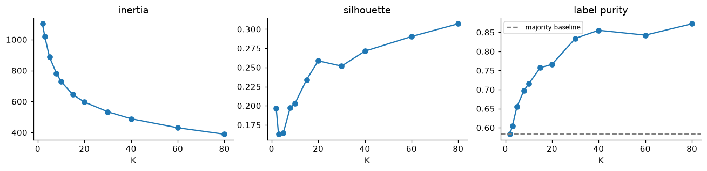
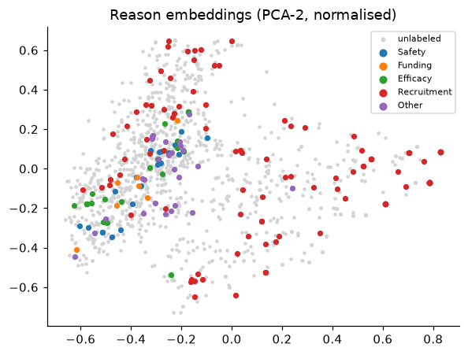
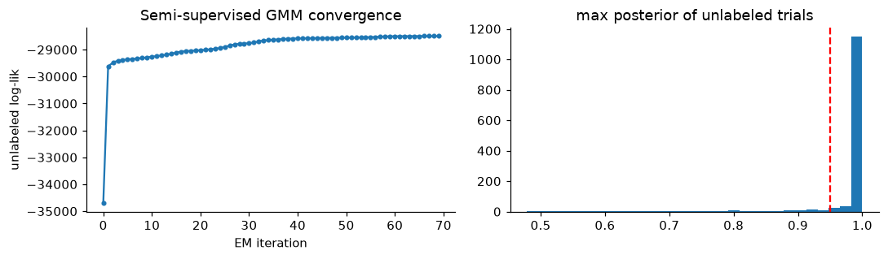
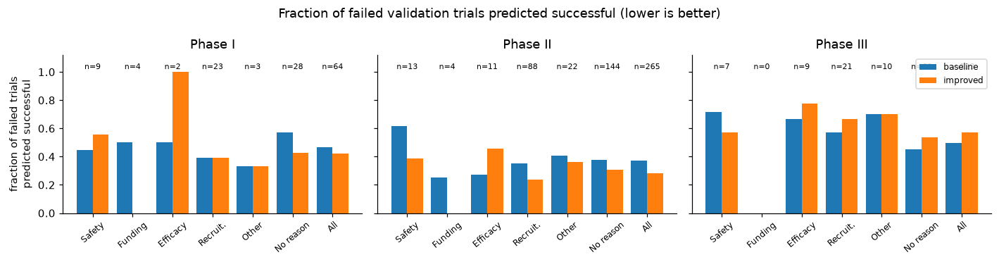

# Labeling Stopping Reasons and Predicting Outcomes of Clinical Trials

**Course:** CS5785 / ORIE5750 / ECE5414, Fall 2026, Midterm Project

**Group members and contributions:**

| Name | Contribution |
|---|---|
| [TBD] | [TBD] |
| [TBD] | [TBD] |

---

## Abstract

Part 1 asks for five stopping-reason labels on 1,171 terminated trials, of which only 157 are labeled. K-means diagnostics show that the reason embeddings have weak cluster structure: silhouette stays between 0.16 and 0.31, and the adjusted Rand index (ARI) against the true label-sets never exceeds 0.20. We compared nine labeling approaches, including cluster voting, cluster-based pseudo-labels, GMM soft labels, a semi-supervised GMM, self-training and label spreading. The selected model averages a supervised logistic regression (LR) with two pseudo-label models. On validation it raises sample-F1 from 0.865 to 0.897 and macro-F1 from 0.707 to 0.806, and most of the macro-F1 gain comes from Funding, which has 8 labeled positives. Part 2 predicts whether a trial met its primary endpoint in each phase. The starter model has a log loss of 0.940, worse than predicting each phase's success rate, because its probabilities are poorly calibrated. One regularized LR on field-wise TF-IDF features, shared across phases through feature augmentation, lowers mean validation log loss to 0.567 and raises ROC-AUC from 0.690 to 0.761. A split by start year suggests that temporal drift costs about 0.07 AUC and leaves log loss almost unchanged.

---

## 1 Methods

### 1.1 Data and constraints

Both parts come from the HINT benchmark [1] and ClinicalTrials.gov [2]. Part 1 has 1,561 terminated trials with a recorded stopping reason. The 312 latest trials (start years 2010–2016) form the test set, and the rest are split at random into train (1,171) and validation (78). Only 157 train trials show their labels: the earliest 10% (117 trials) plus 40 trials chosen for rare reasons. The other 1,014 have all five labels masked. In the labeled set, Recruitment covers 64.3% of trials and Funding 5.1% (8 positives), and 147 of the 157 trials have exactly one reason. The main input is a 150-dimensional reason embedding, a sentence embedding reduced by PCA and randomly rotated, so single coordinates carry no meaning.

In Part 2 each row is one trial in one phase. Train (8,037 rows) and validation (1,013 rows) contain trials that started in 2013 or earlier and are split by trial at random. The test set has 1,500 rows, 500 per phase, from trials that started in 2013–2022. Train success rates are 0.566, 0.477 and 0.653 for phases I, II and III.

We followed the project's restrictions. Reason embeddings and reason labels appear in Part 2 only in the error analysis and never as classifier inputs. `ID` and `trial_id` are used only to match trials across the two parts. No deep learning is used. The semi-supervised methods in Part 1 put the unlabeled test embeddings into the unlabeled pool, which makes the setting transductive; no test labels are involved. Validation trials and cross-validation hold-out folds are never in the pool, so the validation scores are inductive estimates and test performance may be slightly higher.

### 1.2 Part 1: recovering reason labels

**Shared components.** Embeddings are standardized with statistics from the train file, masked rows included. Let $(X_L,Y_L)$ be the labeled set. The unlabeled pool $X_U$ holds the 1,014 masked train trials and the 312 test trials, 1,326 rows in total. Each reason gets its own L2-regularized binary LR with `class_weight="balanced"` (one-vs-rest). Pseudo-labels are down-weighted through `sample_weight`. Scikit-learn multiplies the two weights, so a pseudo-label's effective weight is $w_u$ times its class weight, and rare-class pseudo-labels end up with more weight than $w_u$ alone. Every trial has at least one stopping reason, and an empty prediction scores 0 under sample-wise F1. All methods therefore share one decoding rule: keep every label with probability at least 0.5, and if none passes, keep the most probable one.

**Evaluation.** The validation set has 78 trials, so one changed prediction moves sample-F1 by about 1.3 points. We report validation scores together with 2×5-fold cross-validation (CV) on the 235 labeled trials (157 train plus 78 validation). Each hold-out fold has its labels hidden, and all methods see the same unlabeled pool.

**Cluster diagnostics.** Before designing labeling methods we checked whether the embeddings have usable cluster structure. All 1,561 trials are L2-normalized and reduced to 50 principal components. K-means is run for $K\in\{2,3,5,8,10,15,20,30,40,60,80\}$, and we record inertia, silhouette, the label-set purity of labeled trials, and the ARI [11] between clusters and label-sets.

**Labeling methods.** Nine families, each tuned on validation and CV:

- **A, supervised LR.** Only the 157 labeled trials, $C\in\{0.01,0.1,1,10\}$. This is the reference.
- **B0 / B, K-means cluster-then-label.** $X_L\cup X_U$ is L2-normalized and projected to 50 PCA dimensions. Centroids are initialized with k-means++ [6], the algorithm is restarted 10 times (`n_init=10`) and the run with the lowest inertia is kept (`random_state=42`). Many clusters contain very few labeled trials, so each cluster's label vector is smoothed toward the labeled prior $\bar y$: $\hat y_k=\big(\sum_{i\in L,\,c_i=k}y_i+\bar y\big)/(n_k+1)$. B0 predicts $\hat y_k$ directly. B uses it as a pseudo-label for unlabeled trials and retrains LR with weight $w_u$. We searched $K\in\{10,20,40,80\}$ and $w_u\in\{0.3,1.0\}$.
- **C, K-means and LR agreement.** Cluster voting and the supervised LR each label $X_U$. Only trials where all five labels agree are kept, with the LR labels as pseudo-labels ($w_u=1$). The idea is close to co-training: a clustering model and a discriminative model make different kinds of errors, so their agreement is more reliable. $K\in\{10,20,40\}$.
- **D, GMM soft labels.** A diagonal-covariance GMM on 20 PCA dimensions, `reg_covar=1e-3`, 3 restarts, with component parameters initialized from K-means (the scikit-learn default). Component label means are smoothed toward the prior as in B, and each unlabeled trial gets a posterior-weighted soft label $p$. For LR training it is split into a $y=1$ row with weight $w_u p$ and a $y=0$ row with weight $w_u(1-p)$, $w_u=0.5$, $K\in\{10,20,40\}$.
- **E0 / E, semi-supervised GMM.** Following Nigam et al. [3], each label-set observed in the labeled data gets one Gaussian component in a $d$-dimensional PCA space. The 157 labeled trials contain 7 label-sets (Recruitment 91, Other 19, Efficacy 17, Safety 16, Recruitment+Other 6, Funding+Recruitment 4, Funding 4), so $K=7$. All components share one covariance matrix with a ridge term $10^{-2}I$, because 157 trials are too few to estimate a separate covariance per component in 20 dimensions. Labeled responsibilities are fixed one-hot vectors and never updated.
  - *Initialization.* The first M-step sets all unlabeled responsibilities to zero and estimates $\pi_k,\mu_k,\Sigma$ from labeled data only. No random or K-means initialization is used.
  - *E-step.* For unlabeled trials only, $r_{ik}\propto\pi_k\,\mathcal N(z_i\mid\mu_k,\Sigma)$, normalized with log-sum-exp.
  - *M-step.* Unlabeled responsibilities are scaled by $\lambda$: $N_k=\sum_{i\in L}r_{ik}+\lambda\sum_{i\in U}r_{ik}$ and $\Sigma=\frac{1}{\sum_k N_k}\sum_k\sum_i w_i r_{ik}(z_i-\mu_k)(z_i-\mu_k)^\top+10^{-2}I$. With $\lambda=0$ the model is a generative classifier fit on labeled data alone.
  - *Convergence.* EM stops when the relative change in unlabeled log-likelihood falls below $10^{-5}$, i.e. $|\ell_t-\ell_{t-1}|<10^{-5}|\ell_{t-1}|$, or after 100 iterations.
  - *Prediction.* $P(y_j=1\mid z)=\sum_k p(k\mid z)\,c_{kj}$, where $c_k$ is the label-set of component $k$.

  E0 predicts with this posterior directly, for $d\in\{10,20,40\}$ and $\lambda\in\{0,0.3,1\}$. E keeps only unlabeled trials whose maximum posterior reaches a threshold (0.8 or 0.95), takes their MAP label-set as a pseudo-label ($w_u=0.3$) and retrains LR.
- **F, self-training LR.** In each round, unlabeled trials whose five probabilities all satisfy $|2p_j-1|\ge$ threshold join the training set. At most 5 rounds, threshold 0.8 or 0.95.
- **G, label spreading.** Scikit-learn's LabelSpreading [10] on a kNN graph over the L2-normalized 150-dimensional embeddings, $\alpha=0.5$, at most 200 iterations, run separately per reason, $k\in\{10,20\}$.
- **H, ensemble.** Equal-weight average of the probabilities from A ($C=0.1$), C ($K=20$) and E ($d=20$, threshold 0.95). The three members are a discriminative model, a cluster-agreement pseudo-label model and a generative pseudo-label model, so their errors come from different sources.

**Feature selection.** Starting from the supervised LR ($C=0.1$), we added one feature group at a time and compared validation scores: `start_year`; TF-IDF on the concatenated `criteria`, `diseases_cleaned` and `drugs`, reduced to 50 dimensions with TruncatedSVD; a matched-drug flag plus a multi-hot encoding of drug actions; a multi-hot encoding of the 29 level-0 Reactome pathways [9]; and all of them together. `pathway_level` is the depth of a pathway in the Reactome hierarchy. It describes the pathway, not the drug, so we used it only to pick top-level pathways and not as a numeric feature.

**Final model.** After selection on validation, the chosen model is refit on all 235 labeled trials with the same unlabeled pool. It then predicts the test set and fills in the 1,014 masked train labels.

### 1.3 Part 2: predicting trial outcomes

**Baseline.** The starter code fits one LR per phase on a binary bag of words over the four concatenated text fields (`min_df=3`, at most 20,000 features), with $C=1$.

**Representations and classifiers.** We tried all three representations listed in the project: binary bag of words, TF-IDF on unigrams, and TF-IDF on unigrams and bigrams, the last two with `sublinear_tf` and English stop words. We also tried three classifiers: binary LR ($C\in\{0.01,\dots,1\}$ on bag of words, $C\in\{1,3,10\}$ on TF-IDF); Multinomial NB on counts ($\alpha\in\{1,10\}$) and on TF-IDF ($\alpha\in\{0.1,0.3,1\}$); and distance-weighted kNN with cosine distance, $k\in\{25,75,150\}$.

**Field-wise TF-IDF.** When the four fields are joined into one string, `criteria`, often several hundred words long, outweighs the few words in `drugs` and `icdcodes`. We therefore build one TF-IDF block per field and concatenate them with weights 1.0 for `criteria` and 0.5 for each of the other three. These weights were fixed in advance, not searched. ICD codes are hierarchical: `E11.65` and `E11.9` both belong to type 2 diabetes but are unrelated as separate tokens. We add the three-character category in front of each code (`E11.65` becomes `E11 E11.65`) [12], so codes in the same category share a feature. The drug-knowledge columns form an optional block. Pathway IDs are kept as they are, and targets and actions get `TGT_` and `ACT_` prefixes so that different entity types cannot collide in one vocabulary. Drug structure is encoded with RDKit [7] Morgan fingerprints [8] (radius 2, 1,024 bits). A trial with several drugs takes the bitwise maximum, a trial with no matched drug gets a zero vector, and each row is divided by the square root of its number of set bits so that the block is on a similar scale to the TF-IDF blocks.

**Pooled LR shared across phases.** The project allows either one model per phase or one model that uses the phase. We chose the second option and treat each phase as a domain in the feature augmentation of Daumé III [4]:

$$\phi(x,p)=\big[\,x,\ \mathbb 1[p=\mathrm I]\,x,\ \mathbb 1[p=\mathrm{II}]\,x,\ \mathbb 1[p=\mathrm{III}]\,x,\ e_p\,\big].$$

The effective weight for phase $p$ is $w_0+w_p$, and the one-hot vector $e_p$ gives each phase its own intercept for its success rate. L2 regularization shrinks $w_p$ toward 0, which pulls each phase's model toward the shared weights, so a phase with less data can borrow strength from the others. One LR (liblinear) is fit on all phases together, $C\in\{0.3,1,3\}$. We also tried three ensembles that average the pooled LR with a per-phase TF-IDF LR, kNN, or MNB.

**Error analysis.** As the project specifies, we take the failed trials (label 0) in `outcome_val`, match `trial_id` to the Part 1 `ID`, and look up the true or predicted reason labels. Failed trials with no Part 1 match ran to completion without meeting their endpoint and form a separate "no recorded stopping reason" group. A trial can count toward several reasons. Each phase is analyzed separately, and the code asserts that `trial_id` is unique within a phase. For each group we report the number of trials, how many of their reasons are true labels and how many are Part 1 predictions, and the fraction predicted as successful. Since every trial in a group failed, this fraction is the group's false positive rate (FPR).

**Improvements and trade-offs.** On the selected model we examined four changes: decision thresholds from 0.4 to 0.7; `class_weight="balanced"`; shrinking probabilities toward the phase success rate, $p'=\pi+s(p-\pi)$ with $s\in\{1,0.9,0.8,0.7\}$; and clipping final probabilities to $[0.02,0.98]$. Log loss punishes confident mistakes very heavily ($-\ln 0.02\approx3.9$), and clipping caps that cost.

**Temporal proxy.** The test trials start later than all training data and cannot be evaluated directly. We split train ∪ validation by start year: trials from 2008 or earlier (6,326 rows) for training and from 2010 or later (2,290 rows) for evaluation, with 2009 as a gap. This estimates the validation-to-test gap, and the shrinkage factor $s$ is also chosen on this split.

**Final model.** The selected pooled LR is refit on train ∪ validation (9,050 rows) and predicts the test set.

All models are implemented with scikit-learn [5]. Every figure in this report is produced by code in the submitted notebook.

---

## 2 Results

### 2.1 Part 1

**Cluster diagnostics.** Figure 1 shows the K-means diagnostics. Inertia falls smoothly from $K=2$ to $K=80$ with no elbow. Silhouette is lowest at $K=3$ (0.163) and then rises steadily to 0.307 at $K=80$ without a peak. Purity rises from 0.583 to 0.872, but 0.583 at $K=2$ equals the purity of predicting Recruitment for everyone. ARI peaks at $K=5$ (0.203) and then falls to 0.076 at $K=80$, with 0.107, 0.100 and 0.095 at $K=10$, 20 and 40. Silhouette goes up as ARI goes down, so larger $K$ only cuts the data into smaller pieces and does not move the partition toward the reason labels.

*Figure 1. K-means on all 1,561 trials: inertia, silhouette, and label-set purity of the labeled trials. The dashed line is the purity of predicting Recruitment for every trial (0.583).*

Figure 2 projects the embeddings onto two principal components. Safety, Funding, Efficacy and Other sit together in one region on the left and overlap each other. Recruitment is the most spread-out class: it covers the right half of the plot and also mixes into the dense region on the left.

*Figure 2. Two-dimensional PCA of the L2-normalized reason embeddings. Colored points are labeled trials with a single reason; all other trials are grey.*

**Method comparison.** Table 1 lists a representative configuration from each family. Results for all 40 configurations are in the notebook.

| Method | val s-F1 | val m-F1 | CV s-F1 | CV m-F1 |
|---|---|---|---|---|
| Baseline (starter code) | 0.8654 | 0.7067 | – | – |
| A supervised LR ($C=0.1$) | 0.8590 | 0.7291 | **0.8957** | **0.7979** |
| B0 K-means vote ($K=40$) | 0.8462 | 0.6844 | 0.8195 | 0.6469 |
| B K-means pseudo-labels ($K=40$, $w_u=0.3$) | 0.8162 | 0.6963 | 0.8579 | 0.7347 |
| C K-means ∩ LR ($K=20$) | 0.8761 | 0.7709 | 0.8818 | 0.7688 |
| D GMM soft labels ($K=20$) | 0.7744 | 0.6174 | 0.7924 | 0.6305 |
| E ss-GMM pseudo-labels ($d=20$, thr. 0.95) | 0.8440 | 0.6936 | 0.8630 | 0.7074 |
| F self-training (thr. 0.95) | 0.8654 | 0.7578 | 0.8818 | 0.7817 |
| G label spreading ($k=20$) | 0.6923 | 0.4816 | 0.8319 | 0.5843 |
| **H ensemble (A+C+E)** | **0.8974** | **0.8058** | 0.8900 | 0.7714 |

*Table 1. Part 1 validation scores and 2×5-fold CV scores on the 235 labeled trials. s-F1: sample-wise F1; m-F1: macro-F1.*

The full sweep shows several hyperparameter effects:

- A is insensitive to regularization. Over $C$ from 0.01 to 10, validation sample-F1 stays within 0.859–0.872 and CV sample-F1 within 0.883–0.896.
- B improves with $K$: validation sample-F1 rises from 0.801 at $K=10$ to 0.844 at $K=80$ (with $w_u=0.3$). At $K=10$, B reaches a Safety F1 of only 0.200, against 0.842 for the supervised LR.
- B0 scores a Funding F1 of 0 at both $K=10$ and $K=20$.
- E0 gets worse as unlabeled data gains weight. With $d=10$, moving $\lambda$ from 0 to 1 lowers validation sample-F1 from 0.868 to 0.724 and CV from 0.845 to 0.806. With $d=20$ the drops are 0.846 to 0.795 and 0.870 to 0.829.
- In E, raising the confidence threshold from 0.8 to 0.95 changes validation sample-F1 only from 0.838 to 0.844.
- F with threshold 0.8 reaches 0.895 / 0.769 on validation, close to the best C configuration ($K=10$, 0.893 / 0.785). Table 1 shows F at threshold 0.95.

**EM convergence.** With $d=20$ and $\lambda=1$, the semi-supervised GMM meets the convergence criterion after 70 iterations, below the cap of 100. After convergence, 91.1% of the unlabeled pool has a maximum posterior of at least 0.95 (Figure 3).

*Figure 3. Semi-supervised GMM. Left: unlabeled log-likelihood per EM iteration. Right: maximum posterior of unlabeled trials after convergence; the red line marks 0.95.*

**Selected model.** Table 2 compares the baseline and H per label. H raises macro-F1 by 0.099, and Funding alone gains 0.464. Efficacy drops by 0.028, roughly one trial.

| | Safety | Funding | Efficacy | Recruit. | Other | s-F1 | m-F1 |
|---|---|---|---|---|---|---|---|
| Baseline | 0.857 | 0.286 | 0.828 | 0.980 | 0.583 | 0.865 | 0.707 |
| H | 0.889 | 0.750 | 0.800 | 0.990 | 0.600 | 0.897 | 0.806 |

*Table 2. Per-label validation F1 of the baseline and the selected ensemble H.*

**Feature selection.** In Table 3, only the text SVD block raises validation sample-F1, to 0.872, a gain of 0.013 or about one validation trial. Adding every group gives 0.861, below the text block alone. The final model uses the embeddings only.

| Feature set | Dim. | val s-F1 | val m-F1 |
|---|---|---|---|
| Embedding only (used) | 150 | 0.8590 | 0.7291 |
| + `start_year` | 151 | 0.8526 | 0.7462 |
| + text TF-IDF → SVD-50 | 200 | 0.8718 | 0.7533 |
| + drug-match flag and actions | 180 | 0.8632 | 0.7335 |
| + level-0 Reactome pathways | 179 | 0.8632 | 0.7453 |
| + all | 260 | 0.8611 | 0.7492 |

*Table 3. Feature groups added to the supervised LR ($C=0.1$).*

**Predicted label distribution.** The Safety share is 0.102 in the labeled set, 0.118 in the masked train trials and 0.183 in the test set (the last two predicted). Recruitment goes from 0.643 to 0.687 and 0.580. Funding is predicted for only 0.025 and 0.032 of trials, below its 0.051 share in the labeled set. Of the 312 test predictions, 262 have one label, 49 have two and 1 has three.

### 2.2 Part 2

**Overall comparison.** Table 4 compares the baseline with the selected model, the pooled field-wise TF-IDF LR with $C=1$. All four metrics improve in every phase. Mean log loss falls from 0.9401 to 0.5665, and phase II improves most (1.060 to 0.599).

| Phase | F1 | ROC-AUC | PR-AUC | Log loss |
|---|---|---|---|---|
| I | 0.701 → 0.727 | 0.703 → 0.759 | 0.754 → 0.799 | 0.879 → 0.585 |
| II | 0.614 → 0.645 | 0.663 → 0.737 | 0.638 → 0.718 | 1.060 → 0.599 |
| III | 0.774 → 0.815 | 0.705 → 0.789 | 0.815 → 0.878 | 0.881 → 0.516 |
| Mean | 0.696 → 0.729 | 0.690 → 0.761 | 0.736 → 0.798 | 0.940 → 0.567 |

*Table 4. Part 2 validation results, baseline → selected model.*

Table 5 lists representative results from the 30 configurations, sorted by mean log loss.

| Model | F1 | ROC-AUC | PR-AUC | Log loss |
|---|---|---|---|---|
| Ens.: pooled LR + per-phase TF-IDF 1–2gram LR | 0.7248 | 0.7647 | 0.8021 | 0.5639 |
| Ens.: pooled LR + kNN ($k=75$) | 0.7269 | 0.7653 | 0.8059 | 0.5646 |
| **Pooled field-wise TF-IDF LR, $C=1$ (selected)** | 0.7289 | 0.7612 | 0.7983 | 0.5665 |
| TF-IDF 1–2gram LR, $C=3$ | 0.7227 | 0.7568 | 0.7951 | 0.5700 |
| Field-wise TF-IDF + Morgan fingerprints LR | 0.7182 | 0.7530 | 0.7978 | 0.5754 |
| Field-wise TF-IDF LR, $C=1$ | 0.7222 | 0.7547 | 0.7993 | 0.5756 |
| Field-wise TF-IDF + pathway/target/action LR | 0.7152 | 0.7533 | 0.7981 | 0.5757 |
| TF-IDF unigram LR, $C=3$ | 0.7261 | 0.7462 | 0.7878 | 0.5765 |
| Field-wise TF-IDF + `start_year` LR | 0.7296 | 0.7489 | 0.7929 | 0.5778 |
| Bag-of-words LR, $C=0.01$ | 0.7332 | 0.7374 | 0.7787 | 0.5918 |
| kNN, cosine on TF-IDF, $k=75$ | 0.7181 | 0.7342 | 0.7788 | 0.5980 |
| MNB on TF-IDF, $\alpha=1$ | 0.7182 | 0.7238 | 0.7782 | 0.6524 |
| Baseline: bag-of-words LR, $C=1$ | 0.6962 | 0.6904 | 0.7359 | 0.9401 |
| MNB on counts, $\alpha=1$ | 0.7012 | 0.7142 | 0.7370 | 3.6511 |

*Table 5. Part 2 validation results averaged over the three phases.*

**Error analysis.** Table 6 and Figure 4 give the FPR of failed validation trials by reason group. The no-recorded-reason group accounts for 44%, 54% and 67% of failed trials in phases I, II and III.

*Figure 4. Fraction of failed validation trials predicted as successful, by reason group, for the baseline and the improved model. Phase III has no Funding trials (n = 0), so that bar is empty. The legend in the phase III panel hides two sample sizes: no recorded reason n = 82, all failed trials n = 123.*

| Group | I: n | true/pred | base | impr. | II: n | true/pred | base | impr. | III: n | true/pred | base | impr. |
|---|---|---|---|---|---|---|---|---|---|---|---|---|
| Safety | 9 | 1/8 | 0.444 | 0.556 | 13 | 1/12 | 0.615 | 0.385 | 7 | 1/6 | 0.714 | 0.571 |
| Funding | 4 | 1/3 | 0.500 | 0.000 | 4 | 1/3 | 0.250 | 0.000 | 0 | – | – | – |
| Efficacy | 2 | 0/2 | 0.500 | 1.000 | 11 | 0/11 | 0.273 | 0.455 | 9 | 0/9 | 0.667 | 0.778 |
| Recruitment | 23 | 2/21 | 0.391 | 0.391 | 88 | 12/76 | 0.352 | 0.239 | 21 | 5/16 | 0.571 | 0.667 |
| Other | 3 | 0/3 | 0.333 | 0.333 | 22 | 3/19 | 0.409 | 0.364 | 10 | 2/8 | 0.700 | 0.700 |
| No recorded reason | 28 | – | 0.571 | 0.429 | 144 | – | 0.375 | 0.306 | 82 | – | 0.451 | 0.537 |
| All failed trials | 64 | | 0.469 | 0.422 | 265 | | 0.370 | 0.283 | 123 | | 0.496 | 0.569 |

*Table 6. FPR of failed validation trials by reason group. "true/pred" counts trials whose reason comes from a true label or from a Part 1 prediction. The full lookup table has 235 true and 1,326 predicted labels.*

**Trade-offs.** Table 7 shows the effect of the decision threshold. Raising it from 0.5 to 0.7 lowers the phase II FPR from 0.283 to 0.083 and its F1 from 0.645 to 0.504. The threshold does not affect log loss or ROC-AUC. With `class_weight="balanced"`, mean AUC moves from 0.7612 to 0.7609, log loss rises from 0.5665 to 0.5685, and F1 drops slightly in all three phases. For shrinkage, $s=1$ (no shrinkage) is best on both the random validation split and the temporal split; on the temporal split, $s=1,0.9,0.8,0.7$ give log losses of 0.5672, 0.5683, 0.5717 and 0.5772, so the final model is not shrunk. Test predictions range from 0.080 to 0.979, so clipping to $[0.02,0.98]$ changes almost nothing.

| Thr. | F1 I / II / III | FPR I / II / III | TPR I / II / III |
|---|---|---|---|
| 0.4 | 0.776 / 0.664 / 0.825 | 0.547 / 0.460 / 0.667 | 0.894 / 0.754 / 0.942 |
| **0.5** | 0.727 / 0.645 / 0.815 | 0.422 / 0.283 / 0.569 | 0.753 / 0.627 / 0.888 |
| 0.6 | 0.693 / 0.608 / 0.800 | 0.234 / 0.128 / 0.415 | 0.624 / 0.500 / 0.808 |
| 0.7 | 0.585 / 0.504 / 0.756 | 0.109 / 0.083 / 0.244 | 0.447 / 0.369 / 0.683 |

*Table 7. Selected model at different decision thresholds (0.5 is used).*

**Temporal drift.** On the split by start year, the pooled LR's mean AUC drops from 0.7612 (random validation) to 0.6948, and its log loss goes from 0.5665 to 0.5672. For the baseline, AUC drops from 0.6904 to 0.6173 and log loss rises from 0.9401 to 1.0184. Trials from 2010 or later succeed at a rate of 0.655, against 0.522 for trials from 2008 or earlier.

---

## 3 Discussion

### 3.1 Part 1

**Reasons do not form clusters in embedding space.** The cluster diagnostics and the classification results agree. Silhouette is low with no peak, and ARI reaches only 0.20, so K-means clusters overlap only partly with reason categories. Figure 2 suggests that the only split clustering can make is Recruitment against everything else, while the four minority reasons share one region. Methods that rely on cluster structure alone do worst: the validation macro-F1 of B0, D and G is 0.684, 0.617 and 0.482, all below the supervised LR trained on 157 labels. Rare classes suffer most. At $K=10$ and $K=20$, B0 does not predict a single Funding trial correctly. The 8 labeled Funding trials fall into clusters dominated by Recruitment, and the smoothed cluster label vectors never give Funding a share of 0.5. Sample-F1 is dominated by Recruitment, which covers 64% of trials and is the one class clustering roughly separates, so these methods lose little sample-F1 but a lot of macro-F1. Our reading is that sentence embeddings capture similarity in wording. "Stopped for safety concerns" and "stopped for lack of efficacy" are phrased alike but belong to different classes, while recruitment problems are described in many different ways and spread across the space.

**Pseudo-labels help only after filtering.** Without filtering, B ($K=40$, $w_u=0.3$) reaches 0.816 on validation and 0.858 in CV, below A, which uses no unlabeled data (0.859 / 0.896). C, filtered by agreement, and F, filtered by confidence, both beat A on validation. The 1,326 unlabeled trials outnumber the labeled ones more than 8 to 1, so unfiltered noisy pseudo-labels dominate the loss even at weight 0.3. The trials that survive filtering are mostly far from the decision boundary. They let the model cover parts of the embedding space that the 157 early labeled trials miss, which acts mainly as regularization and adds little new class information. F does as well as C without any clustering, which also points to filtered pseudo-labels as the source of the gain. Clustering contributes to C as a judgment that is independent of the LR. That contribution is real, but it does not mean the clusters reveal reason structure.

**The semi-supervised GMM converges but is confidently wrong.** EM converges in 70 iterations and 91.1% of unlabeled trials have a posterior above 0.95, yet the GMM classifies worse than the supervised LR. The direction of $\lambda$ is stronger evidence. In CV, the score falls monotonically as $\lambda$ grows for all three values of $d$ (for $d=40$: 0.886, 0.865, 0.829), and on validation the only exception is $d=40$, $\lambda=0.3$. Nigam et al. [3] showed that when the generative model is misspecified, EM pulls the parameters away from where the labeled data put them, toward a higher likelihood and a worse classifier. Our model assumes one Gaussian per label-set with a shared covariance. In Figure 2, Recruitment is spread widely while the minority classes sit in a small region, and one shared covariance cannot describe both spreads. Component size is a second problem: Funding's 8 positives are split over three components, and the Funding-only component has 4 trials to estimate its mean. Under misspecification a high posterior reflects the model's certainty, not its accuracy, which is why raising the threshold from 0.8 to 0.95 barely helps.

**Validation and CV disagree on model choice.** H is best on both validation metrics but trails A in CV. Its CV sample-F1 is 0.890 against 0.896, a difference within noise; its CV macro-F1 is 0.771 against 0.798, 0.027 lower. We still chose H for three reasons. First, the project asks for model selection on validation. Second, H's advantage is on the rare classes: its Funding F1 of 0.750 is the highest of all 40 configurations, and its Other F1 of 0.600 is above A's 0.455. Averaging three models with different biases lowers the variance of rare-class predictions, which is a concrete mechanism and not only a score. Third, each CV fold trains on about 188 trials, fewer than the 235 of the final model, and the pseudo-label filters in C and E are less stable with less data. Even so, 78 validation trials are not enough to separate A, C and H statistically.

**Feature selection.** The extra features (criteria, diseases, drugs, pathways) describe trial design, while the stopping reason text is already in the embedding. With 157 labeled trials, the 29–110 extra dimensions mostly add variance. The best single group, text SVD, gains 0.013, one validation trial and less than the noise of the validation set, so it is not enough to justify adding it. Adding all groups scores below the text group alone, which suggests the groups share little complementary signal while their noise adds up. We excluded `start_year` for a reason unrelated to its score. The labeled trials are early and the test trials are the latest, and the project states that Recruitment is more common early and Safety later. A model that learns "early means Recruitment" from the year would fail on the test set. The predicted distribution supports this choice. Without any year information, the model predicts Safety for 0.183 of test trials, well above the 0.102 in the labeled set, and Recruitment falls from 0.643 to 0.580, in the direction the project describes. The lower Funding share in the predictions is consistent with how the labels were sampled: the 40 extra labeled trials were picked for rare reasons, which inflates Funding in the labeled set.

### 3.2 Part 2

**The baseline's main problem is calibration.** Predicting each phase's success rate gives a log loss of about 0.67, and the baseline's 0.940 is worse than that. About 20,000 features, 1,012–3,950 rows per phase and the weak regularization of $C=1$ make the training data nearly linearly separable, so coefficients grow and probabilities are pushed toward 0 and 1. Changing only $C$ from 1 to 0.01 in the bag-of-words LR lowers log loss to 0.592, while AUC moves only from 0.690 to 0.737. Regularization changes log loss far more than it changes ranking quality.

**The evaluation metric changes which models look good.** MNB on counts has an ordinary AUC (0.714) and F1 (0.701) but a log loss of 3.65. Our explanation is that MNB treats words as conditionally independent, while words in `criteria` are strongly correlated, so hundreds of correlated words are counted as independent evidence and the posterior becomes extreme. On TF-IDF features its log loss falls to 0.65–0.72, and raising $\alpha$ from 0.1 to 1 lowers it further at a small cost in AUC. Judged by F1 or AUC, MNB looks usable; judged by the Kaggle log loss, it is not. The kNN probability is a weighted share of neighbor votes and is bounded by construction, so its log loss stays moderate, but its ranking is always behind LR. Among representations, TF-IDF with bigrams beats TF-IDF on unigrams, which beats bag of words.

**Sharing across phases helps phases II and III.** Compared with per-phase field-wise LRs, the pooled model raises AUC by 0.012 in phase II and 0.013 in phase III, lowers it by 0.005 in phase I, and lowers mean log loss from 0.5756 to 0.5665. Phase I has the least training data and should benefit most from borrowing, yet it is the only phase that gets worse. We suspect the reason is that phase I endpoints are mostly about safety and dosing and differ most from the efficacy endpoints of phases II and III, so shared weights do little for phase I, while phases II and III define success in similar ways and borrow from each other well. Both of those phases have more data than phase I, so the gain more likely comes from signal transferring between adjacent phases than from extra sample size. Field-wise TF-IDF on its own is close to a single TF-IDF (0.5756 against 0.5700). Its main role is to provide the feature base for the pooled model.

**Domain-knowledge features do not help.** Adding pathways, targets and actions, Morgan fingerprints, or `start_year` to field-wise TF-IDF changes log loss by less than 0.003 and lowers AUC slightly in each case. We see two likely causes. Only 45.7% of train rows have a matched drug, and biologics such as antibodies are systematically unmatched, so these features say nothing about more than half of the data. Second, drug structure and pathways describe what a drug does biologically, while meeting a primary endpoint also depends on design choices such as the endpoint itself, eligibility criteria and statistical power; the drug names in `drugs` already identify the drug. This matches the Part 1 result: features describing trial design add little information about either stopping reasons or outcomes. `start_year` fails for the same reason as in Part 1, since train and test years barely overlap and a year coefficient can only extrapolate.

**Ensembles were not adopted.** The best ensemble improves log loss over the pooled LR by 0.0026, which 1,013 validation rows cannot resolve, so we kept the simpler single model. In Part 1 we did use an ensemble, because it gained more than 0.03 validation macro-F1 and had a mechanism on the rare classes. The Part 2 ensembles have neither.

**Error rates by reason group.** Two limits apply before reading Table 6. The first is sample size. Funding has 4, 4 and 0 trials across the phases and phase I Efficacy has 2, so one trial moves the rate by 0.25–0.5, and the drop of Funding from 0.500 to 0 is not evidence of improvement. We only interpret groups with $n\ge10$. The second is the reliability of the reason labels. Most groups rely on Part 1 predictions; for example, only 12 of the 88 phase II Recruitment trials have true labels. Prediction errors are not spread evenly across classes. The selected Part 1 model has a validation F1 of 0.99 for Recruitment, so the largest group is assigned reliably, but only 0.75 for Funding and 0.60 for Other, so a fair share of those trials may be in the wrong group. Funding is also the smallest group, and with both problems combined its results cannot be interpreted.

Among groups with enough trials, the no-recorded-reason group is the largest, with 44–67% of failed trials. These trials ran to completion without meeting their endpoint, and their text looks much like that of successful trials; the baseline's FPR on them in phase I is 0.571, its highest among groups with $n\ge10$. The clearest improvement is in the phase II Recruitment group ($n=88$, 0.352 to 0.239). One possible explanation is that trials stopped for poor recruitment tend to have narrow or unusual eligibility criteria, which appear in `criteria` and can be picked up by bigram features, though we did not test this directly. In phase III, the Safety and Efficacy groups have FPRs between 0.57 and 0.78 under both models, but each has fewer than 10 trials, so this is only a tendency. If it holds, a likely cause is that large confirmatory trials have well-written design text and fail because of how the drug actually performs, which the input features do not capture.

**Higher FPR in phase III.** The phase III FPR over all failed trials rises from 0.496 to 0.569 while F1, AUC and log loss all improve. The two are compatible. Phase III's success rate is 0.653, and the improved model is closer to this prior, so it predicts success more often: more failed trials are called successful, and recall on the majority of successful trials rises. If the goal is to screen out likely failures, a threshold of 0.6–0.7 fits better; if the goal is calibrated probabilities, as on Kaggle, 0.5 should stay. Phase III has the highest FPR at every threshold, so with one shared threshold its higher success rate shows up directly in the results.

**Class weighting and shrinkage do not help.** Success rates range from 0.477 to 0.653, so the classes are already close to balanced. `class_weight="balanced"` only moves the decision boundary and makes the calibration worse. Shrinkage is best at $s=1$ on both splits, which suggests the regularized LR is already well calibrated and needs no post-hoc adjustment.

**From validation to test.** On the temporal split, AUC drops from 0.761 to 0.695 for the pooled LR and from 0.690 to 0.617 for the baseline, about 0.07 in both cases, so we expect test AUC to be about 0.07 below validation. Possible causes include new drug names, new therapies, changes in how eligibility criteria are written, and a shift in indications. The pooled LR's log loss barely moves (0.5665 against 0.5672), while the baseline's rises from 0.940 to 1.018. For the pooled LR, weaker ranking should raise log loss, but later trials succeed more often (0.655 against 0.522), the phase intercepts partly absorb this, and the two effects roughly cancel. The baseline's probabilities are already extreme, and drift turns more of those extreme predictions into errors. Test trials start in 2013–2022, further from the training data than in this experiment, so the real drop may be larger.

### 3.3 Limitations and future work

HINT labels may still be noisy after the 7 corrections made by the course staff, which limits how well Part 2 can do, but we did not quantify this. In Part 1, 16.0% of test predictions have more than one label, against 6.4% in the labeled set. Averaging in the ensemble may push a second label that all three members weakly favor over 0.5, and a higher threshold for the second label could fix this. In Part 2, per-phase quantile thresholds could balance FPR across phases. We did not try DBSCAN, and Part 1 does not use a kNN classifier. Part 1 does not use MNB because the reason embeddings contain negative values and MNB needs non-negative features. Tanimoto similarity and molecular descriptors from RDKit, and a search over field weights in Part 2, are left for future work.

---

## References

[1] T. Fu, K. Huang, C. Xiao, L. M. Glass, and J. Sun. HINT: A hierarchical interaction network for clinical-trial outcome prediction. *Patterns*, 3(4):100445, 2022.

[2] U.S. National Library of Medicine. ClinicalTrials.gov. https://clinicaltrials.gov

[3] K. Nigam, A. K. McCallum, S. Thrun, and T. Mitchell. Text classification from labeled and unlabeled documents using EM. *Machine Learning*, 39(2–3):103–134, 2000.

[4] H. Daumé III. Frustratingly easy domain adaptation. In *Proceedings of ACL*, pages 256–263, 2007.

[5] F. Pedregosa et al. Scikit-learn: Machine learning in Python. *Journal of Machine Learning Research*, 12:2825–2830, 2011.

[6] D. Arthur and S. Vassilvitskii. k-means++: The advantages of careful seeding. In *Proceedings of SODA*, pages 1027–1035, 2007.

[7] G. Landrum et al. RDKit: Open-source cheminformatics. https://www.rdkit.org

[8] D. Rogers and M. Hahn. Extended-connectivity fingerprints. *Journal of Chemical Information and Modeling*, 50(5):742–754, 2010.

[9] M. Gillespie et al. The Reactome pathway knowledgebase 2022. *Nucleic Acids Research*, 50(D1):D687–D692, 2022.

[10] D. Zhou, O. Bousquet, T. N. Lal, J. Weston, and B. Schölkopf. Learning with local and global consistency. In *Advances in Neural Information Processing Systems 16*, pages 321–328, 2004.

[11] L. Hubert and P. Arabie. Comparing partitions. *Journal of Classification*, 2(1):193–218, 1985.

[12] World Health Organization. International Statistical Classification of Diseases and Related Health Problems (ICD-10). https://icd.who.int
