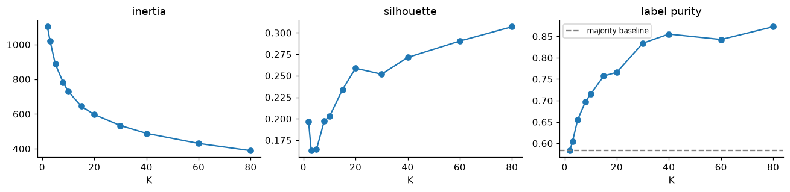
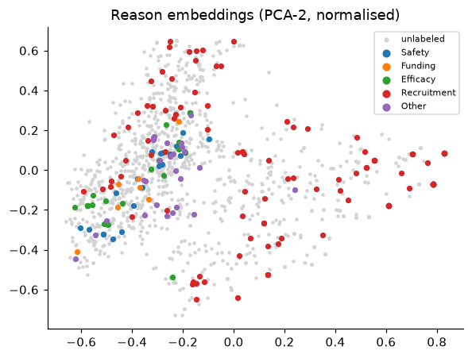
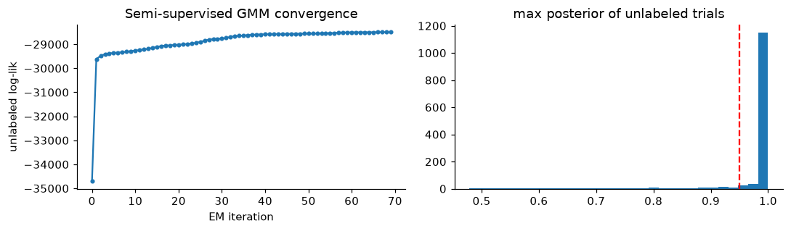
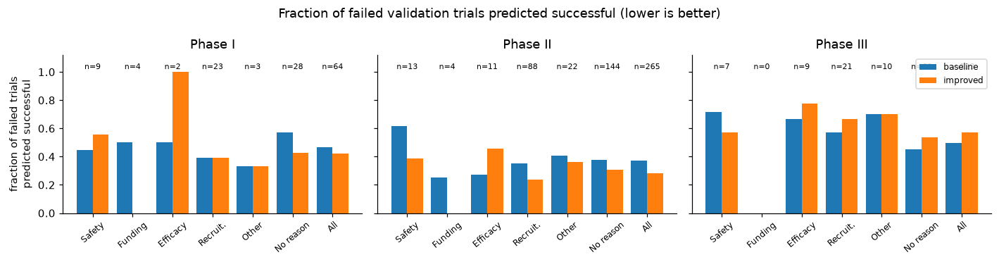

# 临床试验停止原因标注与试验结局预测

**课程：** CS5785 / ORIE5750 / ECE5414，Fall 2026，Midterm Project

**组员与分工：**

| 姓名 | 负责的工作 |
|---|---|
| 【待补充】 | 【待补充】 |
| 【待补充】 | 【待补充】 |

---

## 摘要

本项目包含两个相互衔接的任务。Part 1 中，1,171 个训练试验只有 157 个带停止原因标签，本组需要为其余试验补全五类 reason 标签。本组先用 K-means 诊断 reason embedding 的簇结构，发现结构很弱（silhouette 0.16–0.31，与真实 label-set 的 ARI 最高只有 0.20），随后比较了九类标注方法，覆盖纯聚类投票、聚类伪标签、GMM 软标签、半监督 GMM、自训练和标签传播。最终选用三个模型的概率平均，验证集 sample-F1 从 baseline 的 0.865 提高到 0.897，macro-F1 从 0.707 提高到 0.806，macro-F1 的提升主要来自只有 8 个正例的 Funding 类。Part 2 为三个 phase 预测试验是否达到主要终点。baseline 的 log loss 为 0.940，比直接输出各 phase 的成功率还差，问题出在概率校准。改用分字段 TF-IDF，并按 Daumé III 的方式做 phase 特征增广后，三个 phase 共用一个正则化 LR，验证集平均 log loss 降到 0.567，ROC-AUC 从 0.690 升到 0.761。按开始年份切分的代理实验显示，时间漂移会使 AUC 再下降约 0.07，而 log loss 基本不变。

---

## 1 方法

### 1.1 数据与约束

两部分数据都来自 HINT benchmark [1] 和 ClinicalTrials.gov [2]。Part 1 的 1,561 个试验都是提前终止且记录了停止原因的试验，按开始年份划分：最晚的 312 个（2010–2016）作为 test，其余随机分为 train（1,171）和 val（78）。train 中可见标签的 157 个试验由最早的 10%（117 个）和另外挑选的 40 个稀有原因试验组成，其余 1,014 个的五个标签全部被遮蔽。有标签集中 Recruitment 占 64.3%，Funding 只占 5.1%（8 个正例）；157 个中有 147 个恰好只有一个原因。主要特征是 150 维 reason embedding，由句向量经 PCA 降维并随机旋转得到，单个维度没有含义。

Part 2 每行对应"一个试验在一个 phase"，train 8,037 行、val 1,013 行，均为 2013 年及以前开始的试验，按试验随机划分；test 1,500 行（每个 phase 500 行）来自 2013–2022 年开始的试验。三个 phase 在 train 上的成功率分别为 0.566、0.477、0.653。

本组遵守了题目的各项限制：Part 2 的分类器没有使用 reason embedding 和 reason 标签，它们只出现在错误分析中；`ID` 与 `trial_id` 只用于匹配两部分的试验；全程没有使用深度学习。Part 1 的半监督方法把 test 的 embedding（不含任何标签）放进无标签池，属于转导式设定。val 和交叉验证的留出折都不在无标签池中，所以验证分数是归纳式估计，test 上的实际表现可能略高。

### 1.2 Part 1：reason 标签恢复

**预处理与公共组件。** embedding 先做标准化，均值和方差只用 train 文件（含被遮蔽的行）估计。记有标签集为 $(X_L, Y_L)$，无标签池 $X_U$ 由 1,014 个被遮蔽的 train 试验和 312 个 test 试验组成，共 1,326 行。每个 reason 训练一个二分类 LR（即 one-vs-rest），L2 正则，`class_weight="balanced"`。伪标签通过 `sample_weight` 降权，sklearn 中两种权重是相乘的，所以伪标签的实际权重是 $w_u$ 乘以对应类别的平衡权重，稀有类伪标签的权重会高于 $w_u$ 本身。数据集里每个试验都至少有一个停止原因，空预测在 sample-wise F1 下记 0 分，因此所有方法的输出都经过同一个解码规则：概率不低于 0.5 的标签全部保留，若没有标签过阈值，则取概率最大的那个。

**评估协议。** val 只有 78 个试验，一个试验的预测变化就会让 sample-F1 变动约 1.3 个百分点。为此本组同时报告两组分数：val 分数，以及在 157 个有标签 train 与 78 个 val 合并而成的 235 个样本上做的 2 次重复 5 折交叉验证。每一折的留出部分隐藏标签，所有方法看到的无标签池完全相同。

**聚类诊断。** 设计标注方法之前，本组先检查 embedding 是否有可以利用的簇结构。全部 1,561 个试验先做 L2 归一化再降到 PCA-50，对 $K\in\{2,3,5,8,10,15,20,30,40,60,80\}$ 运行 K-means，记录 inertia、silhouette、有标签样本的 label-set purity，以及簇划分与 label-set 划分之间的 ARI [11]。

**标注方法。** 共九类，均在验证集与交叉验证上调参：

- **A 监督 LR**：只用 157 个有标签样本，$C\in\{0.01,0.1,1,10\}$，作为参照。
- **B0 / B K-means 先聚类后标注**：$X_L\cup X_U$ 做 L2 归一化后降到 PCA-50，运行 K-means。质心用 k-means++ 初始化 [6]，重启 10 次（`n_init=10`）并取 inertia 最小的一次，`random_state=42`。很多簇只含极少的有标签成员，所以簇 $k$ 的标签向量向全局先验 $\bar y$ 做加一平滑：$\hat y_k=\big(\sum_{i\in L,\,c_i=k} y_i+\bar y\big)/(n_k+1)$。B0 直接用所属簇的 $\hat y_k$ 作预测；B 把它当作无标签样本的伪标签，以权重 $w_u$ 与真标签一起重训 LR。扫描范围 $K\in\{10,20,40,80\}$，$w_u\in\{0.3,1.0\}$。
- **C K-means 与 LR 一致性过滤**：分别得到簇投票和监督 LR 对 $X_U$ 的预测，只保留五个标签位完全一致的样本，以 LR 的预测作伪标签（$w_u=1$）重训。思路接近 co-training，聚类与判别模型的错误模式不同，二者一致的样本更可信。$K\in\{10,20,40\}$。
- **D GMM 软标签**：在 PCA-20 上拟合对角协方差 GMM，`reg_covar=1e-3`，重启 3 次；分量参数用 sklearn 默认的 K-means 结果初始化。分量的标签均值同样向先验平滑，再按后验加权得到无标签样本的软标签。训练 LR 时，每个无标签样本拆成 $y=1$ 和 $y=0$ 两行，权重分别为 $w_u p$ 和 $w_u(1-p)$，$w_u=0.5$，$K\in\{10,20,40\}$。
- **E0 / E 半监督 GMM**：按 Nigam 等人 [3] 的做法，在 PCA-$d$ 空间里为有标签集中出现过的每个 label-set 设一个高斯分量。157 个有标签样本中共出现 7 种 label-set（Recruitment 91、Other 19、Efficacy 17、Safety 16、Recruitment+Other 6、Funding+Recruitment 4、Funding 4），所以 $K=7$。全部分量共享一个协方差矩阵并加岭项 $10^{-2}I$，因为 20 维空间里只靠 157 个样本给每个分量单独估计协方差会接近奇异。有标签样本的 responsibility 固定为 one-hot，在迭代中不更新。
  - 初始化：第一次 M 步把所有无标签样本的 responsibility 设为 0，只用有标签数据估计 $\pi_k,\mu_k,\Sigma$，没有使用随机或 K-means 初始化。
  - E 步：只对无标签样本计算 $r_{ik}\propto\pi_k\,\mathcal N(z_i\mid\mu_k,\Sigma)$，用 logsumexp 归一化。
  - M 步：无标签样本的 responsibility 乘以权重 $\lambda$ 后参与估计，$N_k=\sum_{i\in L}r_{ik}+\lambda\sum_{i\in U}r_{ik}$，$\Sigma=\frac{1}{\sum_k N_k}\sum_k\sum_i w_i r_{ik}(z_i-\mu_k)(z_i-\mu_k)^\top+10^{-2}I$。$\lambda=0$ 时模型退化为只用有标签数据的生成式分类器。
  - 收敛判据：无标签对数似然的相对变化 $|\ell_t-\ell_{t-1}|<10^{-5}|\ell_{t-1}|$，最多 100 次迭代。
  - 预测：$P(y_j=1\mid z)=\sum_k p(k\mid z)\,c_{kj}$，其中 $c_k$ 是第 $k$ 个分量对应的 label-set。

  E0 直接用这个后验作预测，扫描 $d\in\{10,20,40\}$、$\lambda\in\{0,0.3,1\}$。E 只保留最大后验不低于阈值的无标签样本，以 MAP label-set 作伪标签（$w_u=0.3$）重训 LR，阈值取 0.8 或 0.95。
- **F 自训练 LR**：每轮把五个概率都满足 $|2p_j-1|\ge$ 阈值的无标签样本加入训练集，最多 5 轮，阈值取 0.8 或 0.95。
- **G 标签传播**：用 sklearn 的 LabelSpreading [10]，在 L2 归一化的 150 维空间上建 kNN 图，$\alpha=0.5$，最多 200 次迭代，每个 reason 单独运行，$k\in\{10,20\}$。
- **H 集成**：A（$C=0.1$）、C（$K=20$）和 E（$d=20$，阈值 0.95）三者的概率等权平均。这三个模型分别属于纯判别、聚类一致性伪标签和生成式伪标签，错误来源不同。

**特征选择。** 在监督 LR（$C=0.1$）上依次加入以下特征组并在 val 上比较：`start_year`；`criteria`、`diseases_cleaned`、`drugs` 拼接后的 TF-IDF 经 TruncatedSVD 降到 50 维；是否匹配到药物的标志加上 drug action 的 multi-hot 编码；29 个 level-0 Reactome 通路 [9] 的 multi-hot 编码；以及全部特征。`pathway_level` 是通路在层级中的序数深度，描述的是通路本身而不是药物，所以本组只用它筛选顶层通路，没有把它当作数值特征。

**最终模型。** 用 val 选定模型后，在 235 个有标签样本上重训，无标签池不变，然后预测 test 并恢复 1,014 个被遮蔽的 train 标签。

### 1.3 Part 2：试验结局预测

**Baseline。** 起始代码为每个 phase 单独训练一个 LR，特征是四个文本字段拼接后的二值词袋（`min_df=3`，最多 20,000 维），$C=1$。

**文本表示与分类器。** 题目列出的三种表示都做了：二值词袋、TF-IDF unigram、TF-IDF 1–2gram，后两者使用 `sublinear_tf` 和英文停用词。分类器也覆盖了三种：二分类 LR（词袋上 $C\in\{0.01,\dots,1\}$，TF-IDF 上 $C\in\{1,3,10\}$）；Multinomial NB，分别在 count 特征（$\alpha\in\{1,10\}$）和 TF-IDF 特征（$\alpha\in\{0.1,0.3,1\}$）上训练；kNN，用余弦距离并按距离加权，$k\in\{25,75,150\}$。

**分字段 TF-IDF。** 把四个字段拼成一个字符串时，几百词长的 `criteria` 会压过只有几个词的 `drugs` 和 `icdcodes`。本组为每个字段单独建 TF-IDF，再按权重拼接：criteria 1.0，其余三个字段各 0.5。这组权重是先验设定，没有做搜索。ICD 编码是层级结构，`E11.65` 和 `E11.9` 同属 2 型糖尿病，作为独立 token 时彼此无关。因此每个编码前额外加入三位类目前缀（`E11.65` 变成 `E11 E11.65`）[12]，让同一类目下的细分编码共享一个特征。drug knowledge 列作为可选块加入：通路 ID 原样保留，靶点和作用分别加 `TGT_`、`ACT_` 前缀，避免不同类型的实体在同一词袋里撞名。药物结构用 RDKit [7] 计算 Morgan 指纹 [8]（radius 2，1024 位），一个试验的多个药物按位取最大值，无匹配药物时取全零向量；为了与 TF-IDF 块尺度相当，每行再除以非零位数的平方根。

**跨 phase 共享的 pooled LR。** 题目允许"每个 phase 训练一个模型，或训练一个使用 phase 信息的模型"，本组采用后一种，按 Daumé III [4] 的特征增广，把每个 phase 当作一个 domain：

$$\phi(x,p)=\big[\,x,\ \mathbb 1[p=\mathrm I]\,x,\ \mathbb 1[p=\mathrm{II}]\,x,\ \mathbb 1[p=\mathrm{III}]\,x,\ e_p\,\big]$$

phase $p$ 的有效权重是 $w_0+w_p$，one-hot 向量 $e_p$ 作为各 phase 的截距，吸收不同的成功率。L2 正则把 $w_p$ 向 0 收缩，也就是把各 phase 的模型拉向共享权重，样本少的 phase 可以借用其他 phase 的数据。所有 phase 的数据一起拟合一个 LR（liblinear），$C\in\{0.3,1,3\}$。在此基础上还试了三种集成，分别把 pooled LR 与 per-phase TF-IDF LR、kNN、MNB 做概率加权平均。

**错误分析。** 按题目的规定，取 `outcome_val` 中 label=0 的试验，用 `trial_id` 匹配 Part 1 的 `ID`，取真实标签或本组的预测标签；没有匹配上的试验跑完了全程但没有达到终点，归入"无记录停止原因"组。一个试验可以同时计入多个 reason 组。每个 phase 单独统计，并在代码中断言同一 phase 内 `trial_id` 不重复。对每个组报告试验数、其中真标签与预测标签各有多少，以及被错判为成功的比例。由于组内全是失败试验，这个比例就是该组的假阳性率。

**改进与权衡。** 在选定模型上考察了四项调整：把决策阈值设为 0.4–0.7；使用 `class_weight="balanced"`；把概率向 phase 成功率收缩，$p'=\pi+s(p-\pi)$，$s\in\{1,0.9,0.8,0.7\}$；把最终概率截断到 $[0.02,0.98]$。log loss 对接近 0 或 1 的错误预测惩罚极重，$-\ln 0.02\approx3.9$，截断可以去掉这部分尾部风险。

**时间漂移代理实验。** test 来自更晚的年份，无法直接评估。本组把 train∪val 按开始年份切开：2008 年及以前（6,326 行）用于训练，2010 年及以后（2,290 行）用于评估，2009 年作为间隔，以此估计 val→test 的性能差距。收缩系数 $s$ 也在这个切分上选择。

**最终模型。** 在 train∪val（9,050 行）上重训选定的 pooled LR，预测 test。

所有模型都用 scikit-learn [5] 实现。文中的图均由随附 notebook 中的代码生成。

---

## 2 结果

### 2.1 Part 1

**聚类诊断。** 图 1 和表 1 是 K-means 的诊断结果。inertia 从 $K=2$ 到 $K=80$ 平滑下降，没有拐点。silhouette 在 $K=3$ 时最低（0.163），之后随 $K$ 单调上升到 0.307，始终没有出现峰值。purity 随 $K$ 从 0.583 升到 0.872，但 $K=2$ 时的 0.583 恰好等于全部预测 Recruitment 的多数类水平。ARI 在 $K=5$ 时最高（0.203），之后逐渐降到 0.076。silhouette 上升而 ARI 下降，说明 $K$ 越大，得到的只是越来越碎的小簇，并没有逐步逼近 reason 的划分。

*图 1：全部 1,561 个试验上 K-means 的 inertia、silhouette 和有标签样本的 label-set purity。虚线为全部预测 Recruitment 时的 purity（0.583）。*

| $K$ | 2 | 5 | 10 | 20 | 40 | 80 |
|---|---|---|---|---|---|---|
| silhouette | 0.196 | 0.164 | 0.203 | 0.259 | 0.271 | 0.307 |
| purity | 0.583 | 0.655 | 0.715 | 0.766 | 0.855 | 0.872 |
| ARI | 0.041 | 0.203 | 0.107 | 0.100 | 0.095 | 0.076 |

*表 1：部分 $K$ 下的聚类诊断指标。*

图 2 是 embedding 的二维 PCA 投影。Safety、Funding、Efficacy、Other 四个少数类集中在左侧中部的同一片区域，彼此重叠；Recruitment 分布最广，铺满右半部分，也混进了左侧的密集区。

*图 2：L2 归一化后 reason embedding 的 PCA 二维投影。灰点为无标签试验，彩色点为单标签的有标签试验。*

**方法比较。** 表 2 给出每类方法代表配置的结果，全部 40 个配置的结果见随附的 notebook。

| 方法 | val sample-F1 | val macro-F1 | CV sample-F1 | CV macro-F1 |
|---|---|---|---|---|
| Baseline（起始代码） | 0.8654 | 0.7067 | – | – |
| A 监督 LR（$C=0.1$） | 0.8590 | 0.7291 | **0.8957** | **0.7979** |
| B0 K-means 投票（$K=40$） | 0.8462 | 0.6844 | 0.8195 | 0.6469 |
| B K-means 伪标签+LR（$K=40$，$w_u=0.3$） | 0.8162 | 0.6963 | 0.8579 | 0.7347 |
| C K-means∩LR（$K=20$） | 0.8761 | 0.7709 | 0.8818 | 0.7688 |
| D GMM 软标签（$K=20$） | 0.7744 | 0.6174 | 0.7924 | 0.6305 |
| E 半监督 GMM→LR（$d=20$，阈值 0.95） | 0.8440 | 0.6936 | 0.8630 | 0.7074 |
| F 自训练（阈值 0.95） | 0.8654 | 0.7578 | 0.8818 | 0.7817 |
| G 标签传播（$k=20$） | 0.6923 | 0.4816 | 0.8319 | 0.5843 |
| **H 集成（A+C+E）** | **0.8974** | **0.8058** | 0.8900 | 0.7714 |

*表 2：Part 1 各类方法的验证集分数与 2×5 折交叉验证分数（235 个有标签样本）。*

完整扫描中有几条超参数规律：

- A 对正则强度不敏感，$C$ 从 0.01 变到 10 时，val sample-F1 在 0.859–0.872 之间，CV sample-F1 在 0.883–0.896 之间。
- B 随 $K$ 增大而变好，val sample-F1 从 $K=10$ 的 0.801 升到 $K=80$ 的 0.844。$K=10$ 时 Safety 的 F1 只有 0.200，监督 LR 则是 0.842。
- B0 在 $K=10$ 和 $K=20$ 时 Funding 的 F1 都是 0。
- E0 加入无标签数据后反而变差：$d=10$ 时，$\lambda$ 从 0 到 1，val sample-F1 由 0.868 降到 0.724，CV 由 0.845 降到 0.806；$d=20$ 时 val 由 0.846 降到 0.795，CV 由 0.870 降到 0.829。
- E 的置信阈值从 0.8 提高到 0.95，val sample-F1 只从 0.838 变到 0.844。
- F 阈值取 0.8 时 val 达到 0.895 / 0.769，与 C 的最好配置（$K=10$，0.893 / 0.785）相当。表 2 中 F 的代表配置取的是阈值 0.95。

**EM 收敛。** $d=20$、$\lambda=1$ 时，半监督 GMM 迭代 70 次后满足收敛判据，没有达到 100 次的上限。收敛后无标签池中 91.1% 的样本最大后验不低于 0.95（图 3）。

*图 3：左为半监督 GMM 每次 EM 迭代的无标签对数似然，右为收敛后无标签样本最大后验的分布，红线为 0.95。*

**最终模型。** 表 3 按标签比较了 baseline 与 H。H 的 macro-F1 提高 0.099，其中 Funding 一类就提高了 0.464；Efficacy 下降 0.028，约相当于一个试验。

| | Safety | Funding | Efficacy | Recruitment | Other | sample-F1 | macro-F1 |
|---|---|---|---|---|---|---|---|
| Baseline | 0.857 | 0.286 | 0.828 | 0.980 | 0.583 | 0.865 | 0.707 |
| H | 0.889 | 0.750 | 0.800 | 0.990 | 0.600 | 0.897 | 0.806 |

*表 3：baseline 与集成模型 H 在验证集上的逐标签 F1。*

**特征选择。** 表 4 中，只有加入文本 SVD 特征时 val sample-F1 提高到 0.872，增幅 0.013，约等于一个验证试验。把全部特征一起加入时只有 0.861，低于只加文本的结果。最终只使用 embedding。

| 特征集 | 维数 | val sample-F1 | val macro-F1 |
|---|---|---|---|
| 仅 embedding（采用） | 150 | 0.8590 | 0.7291 |
| + start_year | 151 | 0.8526 | 0.7462 |
| + 文本 TF-IDF→SVD-50 | 200 | 0.8718 | 0.7533 |
| + 药物匹配标志与 drug action | 180 | 0.8632 | 0.7335 |
| + level-0 Reactome 通路 | 179 | 0.8632 | 0.7453 |
| + 全部 | 260 | 0.8611 | 0.7492 |

*表 4：监督 LR（$C=0.1$）上的特征组对比。*

**预测标签的分布。** 有标签集、被遮蔽的 train 和 test 中，Safety 的比例依次为 0.102、0.118、0.183（后两者为预测值），Recruitment 依次为 0.643、0.687、0.580。Funding 在两组预测中只有 0.025 和 0.032，低于有标签集的 0.051。test 的 312 个预测中，262 个为单标签，49 个为双标签，1 个为三标签。

### 2.2 Part 2

**总体比较。** 表 5 对比了 baseline 和最终模型（pooled 分字段 TF-IDF LR，$C=1$），各 phase 的四项指标全部提高。平均 log loss 从 0.9401 降到 0.5665，改善最多的是 phase II（1.060 降到 0.599）。

| Phase | F1 | ROC-AUC | PR-AUC | Log loss |
|---|---|---|---|---|
| I | 0.701 → 0.727 | 0.703 → 0.759 | 0.754 → 0.799 | 0.879 → 0.585 |
| II | 0.614 → 0.645 | 0.663 → 0.737 | 0.638 → 0.718 | 1.060 → 0.599 |
| III | 0.774 → 0.815 | 0.705 → 0.789 | 0.815 → 0.878 | 0.881 → 0.516 |
| 平均 | 0.696 → 0.729 | 0.690 → 0.761 | 0.736 → 0.798 | 0.940 → 0.567 |

*表 5：Part 2 验证集上 baseline（箭头左）与最终模型（箭头右）的对比。*

表 6 列出 30 个配置中各类的代表结果，按平均 log loss 排序。

| 模型 | 平均 F1 | 平均 ROC-AUC | 平均 PR-AUC | 平均 log loss |
|---|---|---|---|---|
| 集成：pooled LR + per-phase TF-IDF 1–2gram LR | 0.7248 | 0.7647 | 0.8021 | 0.5639 |
| 集成：pooled LR + kNN（$k=75$） | 0.7269 | 0.7653 | 0.8059 | 0.5646 |
| **pooled 分字段 TF-IDF LR，$C=1$（采用）** | 0.7289 | 0.7612 | 0.7983 | 0.5665 |
| TF-IDF 1–2gram LR，$C=3$ | 0.7227 | 0.7568 | 0.7951 | 0.5700 |
| 分字段 TF-IDF + Morgan 指纹 LR | 0.7182 | 0.7530 | 0.7978 | 0.5754 |
| 分字段 TF-IDF LR，$C=1$ | 0.7222 | 0.7547 | 0.7993 | 0.5756 |
| 分字段 TF-IDF + 通路/靶点/作用 LR | 0.7152 | 0.7533 | 0.7981 | 0.5757 |
| TF-IDF unigram LR，$C=3$ | 0.7261 | 0.7462 | 0.7878 | 0.5765 |
| 分字段 TF-IDF + start_year LR | 0.7296 | 0.7489 | 0.7929 | 0.5778 |
| 词袋 LR，$C=0.01$ | 0.7332 | 0.7374 | 0.7787 | 0.5918 |
| kNN 余弦 TF-IDF，$k=75$ | 0.7181 | 0.7342 | 0.7788 | 0.5980 |
| MNB TF-IDF，$\alpha=1$ | 0.7182 | 0.7238 | 0.7782 | 0.6524 |
| Baseline：词袋 LR，$C=1$ | 0.6962 | 0.6904 | 0.7359 | 0.9401 |
| MNB counts，$\alpha=1$ | 0.7012 | 0.7142 | 0.7370 | 3.6511 |

*表 6：Part 2 部分模型的验证集结果（三个 phase 的平均）。*

**错误分析。** 表 7 和图 4 给出验证集中失败试验按 reason 分组的假阳性率。在三个 phase 中，"无记录停止原因"组分别占失败试验的 44%、54% 和 67%。

*图 4：验证集失败试验在各 reason 组中被预测为成功的比例，baseline 与改进模型对比。phase III 没有 Funding 试验（n=0），因此该位置为空。phase III 子图中被图例遮住的两组样本量为：无记录停止原因 n=82，全部失败试验 n=123。*

| Phase | 组 | n | 真/预测 | Baseline | 改进 |
|---|---|---|---|---|---|
| I | Safety | 9 | 1/8 | 0.444 | 0.556 |
| I | Funding | 4 | 1/3 | 0.500 | 0.000 |
| I | Efficacy | 2 | 0/2 | 0.500 | 1.000 |
| I | Recruitment | 23 | 2/21 | 0.391 | 0.391 |
| I | Other | 3 | 0/3 | 0.333 | 0.333 |
| I | 无记录停止原因 | 28 | – | 0.571 | 0.429 |
| I | 全部失败试验 | 64 | | 0.469 | 0.422 |
| II | Safety | 13 | 1/12 | 0.615 | 0.385 |
| II | Funding | 4 | 1/3 | 0.250 | 0.000 |
| II | Efficacy | 11 | 0/11 | 0.273 | 0.455 |
| II | Recruitment | 88 | 12/76 | 0.352 | 0.239 |
| II | Other | 22 | 3/19 | 0.409 | 0.364 |
| II | 无记录停止原因 | 144 | – | 0.375 | 0.306 |
| II | 全部失败试验 | 265 | | 0.370 | 0.283 |
| III | Safety | 7 | 1/6 | 0.714 | 0.571 |
| III | Funding | 0 | 0/0 | – | – |
| III | Efficacy | 9 | 0/9 | 0.667 | 0.778 |
| III | Recruitment | 21 | 5/16 | 0.571 | 0.667 |
| III | Other | 10 | 2/8 | 0.700 | 0.700 |
| III | 无记录停止原因 | 82 | – | 0.451 | 0.537 |
| III | 全部失败试验 | 123 | | 0.496 | 0.569 |

*表 7：验证集失败试验按 reason 分组的假阳性率。"真/预测"列为该组中 reason 来自真实标签与来自 Part 1 预测的试验数；整个查找表共有 235 个真实标签和 1,326 个预测标签。*

**改进措施的权衡。** 表 8 是决策阈值的影响。阈值从 0.5 提到 0.7 后，phase II 的假阳性率从 0.283 降到 0.083，F1 从 0.645 降到 0.504。阈值不影响 log loss 和 ROC-AUC。使用 `class_weight="balanced"` 后，平均 AUC 由 0.7612 变为 0.7609，log loss 由 0.5665 升到 0.5685，三个 phase 的 F1 都略有下降。概率收缩在随机 val 和时间切分上都以 $s=1$（不收缩）最好：$s$ 取 1、0.9、0.8、0.7 时，时间切分上的 log loss 依次为 0.5672、0.5683、0.5717、0.5772，所以最终没有收缩。test 预测的概率范围为 0.080–0.979，截断到 $[0.02,0.98]$ 几乎没有改变任何预测。

| 阈值 | F1 I / II / III | 假阳性率 I / II / III | 真阳性率 I / II / III |
|---|---|---|---|
| 0.4 | 0.776 / 0.664 / 0.825 | 0.547 / 0.460 / 0.667 | 0.894 / 0.754 / 0.942 |
| 0.5（采用） | 0.727 / 0.645 / 0.815 | 0.422 / 0.283 / 0.569 | 0.753 / 0.627 / 0.888 |
| 0.6 | 0.693 / 0.608 / 0.800 | 0.234 / 0.128 / 0.415 | 0.624 / 0.500 / 0.808 |
| 0.7 | 0.585 / 0.504 / 0.756 | 0.109 / 0.083 / 0.244 | 0.447 / 0.369 / 0.683 |

*表 8：改进模型在不同决策阈值下的表现。*

**时间漂移。** 表 9 是按年份切分的结果。评估集（2010 年以后）的成功率为 0.655，训练集（2008 年以前）为 0.522。

| 模型 | 评估方式 | 平均 ROC-AUC | 平均 log loss |
|---|---|---|---|
| Baseline | 随机 val | 0.6904 | 0.9401 |
| Baseline | 早期→晚期 | 0.6173 | 1.0184 |
| Pooled LR | 随机 val | 0.7612 | 0.5665 |
| Pooled LR | 早期→晚期 | 0.6948 | 0.5672 |

*表 9：随机划分与时间划分下的对比。*

---

## 3 讨论

### 3.1 Part 1

**reason 在 embedding 空间里不成团。** 聚类诊断与分类结果是一致的。silhouette 低且没有峰值，ARI 最高 0.20，说明 K-means 找到的簇与 reason 类别只部分重合。从图 2 看，能被分开的大体只有"Recruitment"与"其他"这一刀，四个少数类挤在同一片区域里。依赖簇结构本身的方法因此表现最差：B0、D、G 的 val macro-F1 分别是 0.684、0.617、0.482，都低于只用 157 个标签的监督 LR。稀有类受到的影响最大。B0 在 $K=10$ 和 $K=20$ 时 Funding 的 F1 都是 0，即簇投票没有正确预测出任何一个 Funding 试验。Funding 的 8 个有标签正例落在以 Recruitment 为主的簇里，平滑后的簇标签向量中 Funding 的比例达不到 0.5。由于 sample-F1 主要由占 64% 的 Recruitment 决定，而 Recruitment 恰好是聚类唯一能大致分出的类，这些方法的 sample-F1 下降并不明显，macro-F1 则大幅下降。本组对这种现象的理解是：句向量反映的是措辞上的相近，"因安全问题终止"与"因疗效不足终止"写法接近，却属于不同类别，而招募不足的说法很多样，在空间里分得很散。

**伪标签只有经过过滤才有用。** 不加过滤的 B（$K=40$，$w_u=0.3$）val sample-F1 为 0.816，CV 为 0.858，都低于不用无标签数据的 A（0.859 / 0.896）。经过一致性过滤的 C 和按置信度筛选的 F，val 分数都超过了 A。无标签样本有 1,326 个，是有标签样本的 8 倍多，即使权重降到 0.3，未经过滤的噪声伪标签仍会主导损失。过滤后留下的多是远离决策边界的样本，它们帮模型覆盖了 157 个早期有标签试验没有覆盖到的区域，主要起正则化作用，带来的新类别信息不多。完全不用聚类的 F 与 C 分数相当，也说明增益主要来自"过滤后的伪标签"这一机制。C 中聚类的作用是提供一个与 LR 独立的判断，这个作用是真实的，但不能说聚类揭示了 reason 的结构。

**半监督 GMM 收敛良好，但伪标签自信地出错。** EM 在 70 次迭代后收敛，91.1% 的无标签样本后验超过 0.95，分类结果却不如监督 LR。更明显的证据是 $\lambda$ 的方向：在 CV 上，三个 $d$ 的结果都随 $\lambda$ 增大而单调下降（例如 $d=40$ 时依次为 0.886、0.865、0.829）；val 上只有 $d=40$、$\lambda=0.3$ 一处例外。Nigam 等人 [3] 指出，生成模型设定错误时，EM 会把参数从有标签数据确定的位置拉向似然更高、分类却更差的位置。本组的模型假设每个 label-set 对应一个高斯且共享协方差。图 2 中 Recruitment 分布很宽，少数类挤在一小片区域，两者的离散程度差别很大，一个共享协方差无法同时刻画这两种结构。另一个不利因素是分量的样本量：Funding 的 8 个正例被拆进三个分量，纯 Funding 分量只有 4 个样本来估计均值。在模型错设的情况下，高后验代表的是模型自身的确定程度，与预测是否正确关系不大，所以把置信阈值从 0.8 提高到 0.95 几乎没有改善结果。

**模型选择中 val 与 CV 不一致。** H 在 val 上两项都最好，但在 CV 上不如 A：sample-F1 为 0.890 对 0.896，差距在噪声范围内；macro-F1 为 0.771 对 0.798，差 0.027。本组仍然选择 H，理由有三点。第一，题目规定用 val 选择模型。第二，H 的优势集中在稀有类上，Funding 的 F1 为 0.750，是全部 40 个配置中最高的，Other 为 0.600，高于 A 的 0.455，对三个偏差来源不同的模型求平均，可以降低稀有类预测的方差，这有明确的机制依据。第三，CV 每折只用约 188 个样本训练，少于最终模型的 235 个，而 C 和 E 的伪标签过滤在样本少时更不稳定。即便如此，78 个验证试验仍不足以在统计上区分 A、C、H 三者的排序。

**特征选择。** 除 embedding 以外的特征（入排标准、疾病、药物、通路）描述的都是试验设计，停止原因的文本信息已经包含在 reason embedding 中。在只有 157 个有标签样本的情况下，多出的 29–110 维主要增加方差。最好的单组（文本 SVD）提升 0.013，相当于一个验证试验，小于 val 本身的波动，所以不足以支持采用。把全部特征一起加入的结果低于只加文本，说明各特征组之间几乎没有互补的信号，噪声却会叠加。排除 `start_year` 的理由与分数无关：有标签集集中在早期，test 在最晚期，题目明确指出 Recruitment 在早期更常见、Safety 在后期更常见，模型若用年份学到"早期即 Recruitment"，这条规律在 test 上会失效。预测分布从侧面支持了这个决定。模型完全没有使用年份，test 上预测的 Safety 比例（0.183）仍明显高于有标签集（0.102），Recruitment 则从 0.643 降到 0.580，方向与题目的描述一致。Funding 的预测比例低于有标签集，这符合采样方式：那 40 个额外的有标签试验是专门为稀有原因挑选的，有标签集中的 Funding 比例本来就被抬高了。

### 3.2 Part 2

**baseline 的主要问题是校准。** 直接输出各 phase 成功率的 log loss 约为 0.67，baseline 的 0.940 比这还差。约 20,000 维的特征、每个 phase 1,012–3,950 行数据、几乎不起作用的 $C=1$ 正则，使训练集接近线性可分，系数变大，概率被推向 0 和 1。只把词袋 LR 的 $C$ 从 1 降到 0.01，log loss 就降到 0.592，AUC 只从 0.690 升到 0.737。可见同一项改动对 log loss 的作用远大于对排序能力的作用。

**评估指标会改变对模型的判断。** MNB 在 count 特征上的 AUC（0.714）和 F1（0.701）都正常，log loss 却高达 3.65。本组的解释是：MNB 假设词与词条件独立，而 `criteria` 中的词高度相关，几百个相关词的证据被当作独立证据相加，后验被推到极端值。换成 TF-IDF 后 log loss 降到 0.65–0.72；把 $\alpha$ 从 0.1 增大到 1，log loss 继续改善，AUC 则略降。如果只看 F1 或 AUC，MNB 似乎可用；按 Kaggle 的 log loss 评价，它几乎不能用。kNN 的概率是邻居投票的加权比例，天然有界，因此 log loss 没有失控，但排序能力始终不如 LR。文本表示方面，TF-IDF 1–2gram 优于 unigram，unigram 又优于词袋。

**跨 phase 共享的增益落在 phase II 和 III。** 与逐 phase 训练的分字段 LR 相比，pooled 模型在 phase II 和 III 上的 AUC 分别提高 0.012 和 0.013，phase I 反而下降 0.005，平均 log loss 从 0.5756 降到 0.5665。phase I 的训练数据最少，按"借用数据"的思路本应受益最多，结果却相反。本组的推测是，phase I 的主要终点多为安全性和剂量，与以疗效为主的 II、III 差别最大，共享权重对它帮助有限；II 和 III 的成功标准更接近，互相借用更有效。phase II 和 III 的样本都多于 phase I，增益却落在这两个 phase 上，这说明 pooled 模型的作用更可能来自相邻 phase 之间的信号迁移，而不是补足样本量。分字段 TF-IDF 本身与单一 TF-IDF 基本持平（0.5756 对 0.5700），它的作用主要是作为 pooled 模型的特征基础。

**领域知识特征没有带来增益。** 在分字段 TF-IDF 的基础上加入通路/靶点/作用、Morgan 指纹或 `start_year`，log loss 的变化都在 0.003 以内，AUC 都略有下降。可能的原因有两层。其一，只有 45.7% 的 train 行匹配到药物，抗体等生物制剂系统性地匹配不上，这些特征对一半以上的数据没有信息。其二，药物结构和作用通路描述的是药物在生物学上做什么，而试验能否达到主要终点还取决于终点选择、入排标准和统计功效等设计因素，`drugs` 字段中的药名也已经提供了药物身份的信息。这与 Part 1 的结论相互印证：描述试验设计的特征，对停止原因和试验结局都没有提供多少额外的信息。`start_year` 的情况也与 Part 1 相同，train 和 test 的年份几乎不重叠，年份系数只能外推。

**集成方法没有被采用。** 最好的集成比单个 pooled LR 低 0.0026 的 log loss，在 1,013 行的验证集上不足以区分，本组因此选择了更简单的单模型。Part 1 采用了集成，是因为它在 val macro-F1 上的提升超过 0.03，并且对稀有类有机制上的解释；Part 2 的集成两者都不具备。

**不同 reason 组的错误率。** 讨论分组结果之前，需要先考虑两个限制。第一是样本量：Funding 在三个 phase 中只有 4、4、0 个试验，phase I 的 Efficacy 只有 2 个，一个试验的变化就能让比例改变 0.25–0.5，所以表中 Funding 从 0.500 降到 0 不能作为改进的证据。本组只解读 $n\ge10$ 的组。第二是 reason 标签本身的可靠性：大多数组的标签来自 Part 1 的预测，例如 phase II 的 Recruitment 组 88 个试验中只有 12 个是真实标签。预测标签的误差在各类之间并不均匀。按 Part 1 选定模型在 val 上的逐标签 F1，Recruitment 为 0.99，这个最大组的分组基本可信；Funding 为 0.75，Other 为 0.60，这两组中有相当一部分试验可能被分错。Funding 同时也是样本量最小的组，两种误差叠加，它的结果基本无法解读。

在样本量足够的组中，"无记录停止原因"组最大，在三个 phase 中占失败试验的 44%–67%。这些试验执行完毕但没有达到终点，从文本上看与成功的试验差别不大，baseline 在 phase I 上对它们的假阳性率最高（0.571）。改进最明显的是 phase II 的 Recruitment 组（n=88，0.352 降到 0.239）。一种可能的解释是，因招募困难而终止的试验，其入排标准往往较窄、要求较特殊，这些信息就写在 `criteria` 里，可以被 bigram 特征捕捉到。不过本组没有专门验证这一点。phase III 的 Safety 和 Efficacy 组在两个模型下的假阳性率都在 0.57–0.78 之间，但这两组 $n<10$，只能作为倾向参考。如果这个倾向成立，原因可能是大型确证性试验的设计文本本身较规范，失败主要来自药物的实际效果，而这类信息不在输入特征中。

**phase III 的假阳性率上升。** phase III 全部失败试验的假阳性率从 0.496 升到 0.569，同时 F1、AUC、log loss 都有改善，两者并不矛盾。phase III 的成功率为 0.653，改进后的模型更接近这个先验，整体上更倾向于预测成功，失败试验中被判为成功的随之增多，而占多数的成功试验的召回率提高了。如果实际用途是筛除可能失败的试验，可以把阈值提高到 0.6–0.7；如果目标是给出校准的概率（Kaggle 的评分方式），就应保持 0.5。phase III 在各个阈值下的假阳性率都高于 I 和 II，采用统一阈值时，它的成功率较高这一点会直接体现在结果中。

**class weighting 与收缩没有带来改进。** 三个 phase 的成功率在 0.477–0.653 之间，类别已接近平衡，`class_weight="balanced"` 只是移动了决策边界，并让原本不错的校准变差。概率收缩在两种切分上都以不收缩为最优，说明正则化之后的 LR 已经校准得较好，不再需要事后调整。

**val 到 test 的差距。** 时间切分实验中，pooled LR 的 AUC 从 0.761 降到 0.695，baseline 从 0.690 降到 0.617，降幅都约为 0.07。本组据此预计 Kaggle test 上的 AUC 会比验证集低 0.07 左右。下降的原因可能包括新药名、新疗法和入排标准写法的变化，以及适应症构成的变化。pooled LR 的 log loss 几乎不变（0.5665 对 0.5672），baseline 则从 0.940 升到 1.018。对 pooled LR 而言，排序能力下降本应推高 log loss，但晚期试验的成功率更高（0.655 对 0.522），而 phase 截距可以部分吸收这一变化，两种效应大致抵消。baseline 的概率本来就很极端，漂移会让更多极端预测出错，log loss 因此进一步变差。test 的开始年份为 2013–2022，与训练数据的时间距离比本实验更远，实际的性能下降可能更大。

### 3.3 局限与后续工作

HINT 的标签经题目方修正了 7 个，仍可能存在噪声，这为 Part 2 的可达性能设了上限，但本组没有量化它的影响。Part 1 的 test 预测中有 16.0% 为多标签，而有标签集只有 6.4%，集成平均可能把三个模型都略微倾向的第二个标签推过了 0.5，为第二个标签设置更高的阈值是一个可行的改进。Part 2 可以尝试按 phase 分别设定分位数阈值，使各 phase 的假阳性率更均衡。本组没有尝试 DBSCAN，Part 1 也没有使用 KNN 分类器。Part 1 没有使用 MNB，因为 reason embedding 含负值，不满足 MNB 对非负特征的要求。Part 2 中 RDKit 的 Tanimoto 相似度与分子描述符、分字段权重的搜索，也都留待后续工作。

---

## 参考文献

[1] T. Fu, K. Huang, C. Xiao, L. M. Glass, and J. Sun. HINT: A hierarchical interaction network for clinical-trial outcome prediction. *Patterns*, 3(4):100445, 2022.

[2] U.S. National Library of Medicine. ClinicalTrials.gov. https://clinicaltrials.gov

[3] K. Nigam, A. K. McCallum, S. Thrun, and T. Mitchell. Text classification from labeled and unlabeled documents using EM. *Machine Learning*, 39(2–3):103–134, 2000.

[4] H. Daumé III. Frustratingly easy domain adaptation. In *Proceedings of ACL*, pages 256–263, 2007.

[5] F. Pedregosa et al. Scikit-learn: Machine learning in Python. *Journal of Machine Learning Research*, 12:2825–2830, 2011.

[6] D. Arthur and S. Vassilvitskii. k-means++: The advantages of careful seeding. In *Proceedings of SODA*, pages 1027–1035, 2007.

[7] G. Landrum et al. RDKit: Open-source cheminformatics. https://www.rdkit.org

[8] D. Rogers and M. Hahn. Extended-connectivity fingerprints. *Journal of Chemical Information and Modeling*, 50(5):742–754, 2010.

[9] M. Gillespie et al. The Reactome pathway knowledgebase 2022. *Nucleic Acids Research*, 50(D1):D687–D692, 2022.

[10] D. Zhou, O. Bousquet, T. N. Lal, J. Weston, and B. Schölkopf. Learning with local and global consistency. In *Advances in Neural Information Processing Systems 16*, pages 321–328, 2004.

[11] L. Hubert and P. Arabie. Comparing partitions. *Journal of Classification*, 2(1):193–218, 1985.

[12] World Health Organization. International Statistical Classification of Diseases and Related Health Problems (ICD-10). https://icd.who.int
