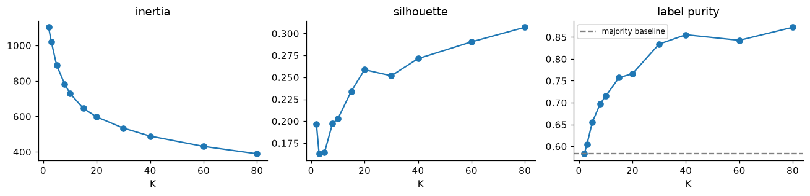
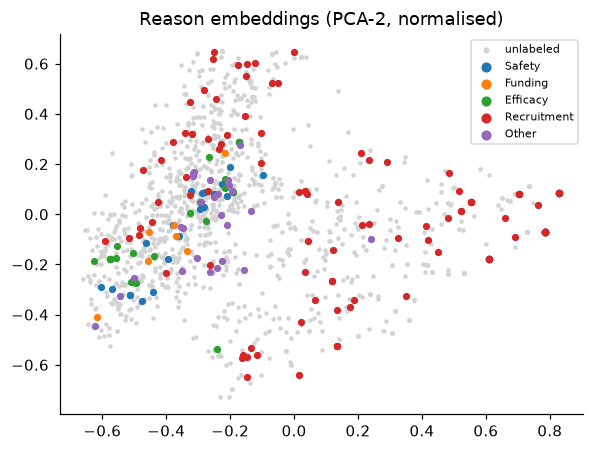
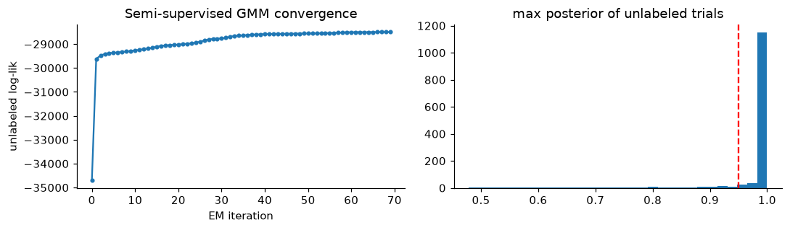
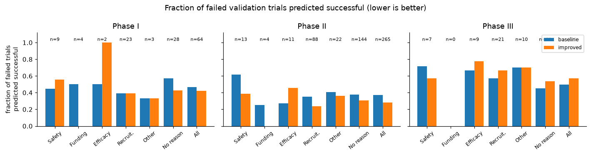

# 临床试验停止原因标注与试验结局预测

**课程：** CS5785 / ORIE5750 / ECE5414，Fall 2026，Midterm Project

**组员与分工：**

| 姓名 | 负责的工作 |
|---|---|
| 【待补充】 | 【待补充】 |
| 【待补充】 | 【待补充】 |

---

## 摘要

Part 1 中，1,171 个训练试验只有 157 个带停止原因标签，本组需要为其余试验补全五类 reason 标签。本组先用 K-means 诊断 reason embedding 的簇结构，发现结构很弱（silhouette 0.16–0.31，与真实 label-set 的 ARI 最高只有 0.20），随后比较了九类标注方法，覆盖纯聚类投票、聚类伪标签、GMM 软标签、半监督 GMM、自训练和标签传播。最终选用三个模型的概率平均，验证集 sample-F1 从 baseline 的 0.865 提高到 0.897，macro-F1 从 0.707 提高到 0.806，macro-F1 的提升主要来自只有 8 个正例的 Funding 类。Part 2 为三个 phase 预测试验是否达到主要终点。baseline 的 log loss 为 0.940，比直接输出各 phase 的成功率还差，问题出在概率校准。改用分字段 TF-IDF，并按 Daumé III 的方式做 phase 特征增广后，三个 phase 共用一个正则化 LR，验证集平均 log loss 降到 0.567，ROC-AUC 从 0.690 升到 0.761。按开始年份切分的代理实验显示，时间漂移会使 AUC 再下降约 0.07，而 log loss 基本不变。

---

## 1 方法

### 1.1 数据与约束

两部分数据都来自 HINT benchmark [1] 和 ClinicalTrials.gov [2]。Part 1 中，最晚的 312 个试验（2010–2016）作为 test，其余随机分为 train（1,171）和 val（78）。train 中可见标签的 157 个试验由最早的 117 个和另外挑选的 40 个稀有原因试验组成。有标签集中 Recruitment 占 64.3%，Funding 只占 5.1%（8 个正例）；157 个中有 147 个恰好只有一个原因。主要特征是 150 维 reason embedding，由句向量经 PCA 降维并随机旋转得到。Part 2 每行对应"一个试验在一个 phase"，train 8,037 行、val 1,013 行，均为 2013 年及以前开始的试验，按试验随机划分；test 1,500 行来自 2013–2022 年开始的试验。三个 phase 在 train 上的成功率分别为 0.566、0.477、0.653。

Part 2 的分类器没有使用 reason embedding 和 reason 标签，它们只出现在错误分析中；`ID` 与 `trial_id` 只用于匹配两部分的试验；全程没有使用深度学习。Part 1 的半监督方法把 test 的 embedding（不含任何标签）放进无标签池，属于转导式设定。val 和交叉验证的留出折都不在无标签池中。

### 1.2 Part 1：reason 标签恢复

**公共组件。** embedding 先用 train 文件的统计量做标准化。无标签池 $X_U$ 由 1,014 个被遮蔽的 train 试验和 312 个 test 试验组成。每个 reason 训练一个二分类 LR，L2 正则，`class_weight="balanced"`。伪标签通过 `sample_weight` 降权，sklearn 中两种权重是相乘的，所以稀有类伪标签的权重会高于 $w_u$ 本身。每个试验都至少有一个停止原因，空预测在 sample-wise F1 下记 0 分，因此所有方法都保留概率不低于 0.5 的标签，若没有标签过阈值，则取概率最大的那个。

**评估协议。** val 只有 78 个试验，一个试验的预测变化就会让 sample-F1 变动约 1.3 个百分点。为此本组同时报告在 157 个有标签 train 与 78 个 val 合并而成的 235 个样本上做的 2 次重复 5 折交叉验证，每一折的留出部分隐藏标签。

**聚类诊断。** 全部 1,561 个试验先做 L2 归一化再降到 PCA-50，对 $K$ 从 2 到 80 运行 K-means，记录 inertia、silhouette、有标签样本的 label-set purity，以及簇划分与 label-set 划分之间的 ARI [11]。

**标注方法。** 共九类，均在验证集与交叉验证上调参：

- **A 监督 LR**：只用 157 个有标签样本，$C\in\{0.01,0.1,1,10\}$。
- **B0 / B K-means 先聚类后标注**：在 L2 归一化的 PCA-50 特征上运行 K-means，质心用 k-means++ 初始化 [6]，重启 10 次并取 inertia 最小的一次。簇的标签向量向先验 $\bar y$ 做加一平滑：$\hat y_k=\big(\sum_{i\in L,\,c_i=k} y_i+\bar y\big)/(n_k+1)$。B0 直接用 $\hat y_k$ 作预测；B 把它当作伪标签，以权重 $w_u\in\{0.3,1\}$ 重训 LR。$K\in\{10,20,40,80\}$。
- **C K-means 与 LR 一致性过滤**：只保留簇投票和监督 LR 在五个标签位上完全一致的无标签样本，以 LR 的预测作伪标签（$w_u=1$）。思路接近 co-training，聚类与判别模型的错误模式不同。$K\in\{10,20,40\}$。
- **D GMM 软标签**：在 PCA-20 上拟合对角协方差 GMM，`reg_covar=1e-3`，重启 3 次；分量参数用 sklearn 默认的 K-means 结果初始化。每个无标签样本按后验得到软标签 $p$，拆成 $y=1$ 和 $y=0$ 两行，权重分别为 $w_u p$ 和 $w_u(1-p)$，$w_u=0.5$。
- **E0 / E 半监督 GMM**：按 Nigam 等人 [3] 的做法，为有标签集中出现过的每个 label-set 设一个高斯分量。共出现 7 种 label-set，所以 $K=7$（Funding 的 8 个正例分在其中三个分量）。全部分量共享一个协方差矩阵并加岭项 $10^{-2}I$，因为只靠 157 个样本给每个分量单独估计协方差会接近奇异。EM 在 PCA-$d$ 空间中进行。初始化：第一次 M 步只用有标签样本的 one-hot responsibility，没有使用随机或 K-means 初始化；有标签样本的 responsibility 在迭代中不更新。E 步：对无标签样本计算 $r_{ik}\propto\pi_k\,\mathcal N(z_i\mid\mu_k,\Sigma)$。M 步：无标签样本的 responsibility 乘以权重 $\lambda$，$\lambda=0$ 时模型退化为只用有标签数据的生成式分类器。收敛判据：无标签对数似然的相对变化小于 $10^{-5}$，最多 100 次迭代。预测为 $P(y_j=1\mid z)=\sum_k p(k\mid z)\,c_{kj}$，其中 $c_k$ 是第 $k$ 个分量对应的 label-set。E0 直接用这个后验作预测（$d\in\{10,20,40\}$，$\lambda\in\{0,0.3,1\}$）。E 只保留最大后验不低于 0.8 或 0.95 的无标签样本，以 MAP label-set 作伪标签（$w_u=0.3$）。
- **F 自训练 LR**：最多 5 轮，五个概率都满足 $|2p_j-1|\ge 0.8$ 或 $0.95$ 的无标签样本加入训练集。
- **G 标签传播** [10]：在 kNN 图上运行（$k\in\{10,20\}$，$\alpha=0.5$），每个 reason 单独运行。
- **H 集成**：A（$C=0.1$）、C（$K=20$）和 E（$d=20$，阈值 0.95）三者的概率等权平均，三者错误来源不同。

**特征选择。** 在监督 LR 上依次加入：`start_year`；`criteria`、`diseases_cleaned`、`drugs` 的 TF-IDF 经 SVD 降到 50 维；药物匹配标志与 drug action 的 multi-hot 编码；level-0 Reactome 通路 [9] 的 multi-hot 编码；以及全部特征。`pathway_level` 描述的是通路本身而不是药物，所以只用它筛选顶层通路。选定的模型在 235 个有标签样本上重训。

### 1.3 Part 2：试验结局预测

**Baseline。** 每个 phase 单独训练一个 LR，特征是四个文本字段拼接后的二值词袋（最多 20,000 维），$C=1$。

**文本表示与分类器。** 二值词袋、TF-IDF unigram、TF-IDF 1–2gram，分类器为 LR（$C$ 从 0.01 到 10）、Multinomial NB（count 或 TF-IDF 特征，$\alpha$ 从 0.1 到 10）和按距离加权的余弦 kNN（$k\in\{25,75,150\}$）。

**分字段 TF-IDF。** 把四个字段拼成一个字符串时，`criteria` 会压过 `drugs` 和 `icdcodes`。本组为每个字段单独建 TF-IDF，再按固定权重拼接：criteria 1.0，其余三个字段各 0.5。每个 ICD 编码前加入三位类目前缀（`E11.65` 变成 `E11 E11.65`）[12]，让同一类目下的编码共享一个特征。可选块包括 drug knowledge（靶点和作用分别加 `TGT_`、`ACT_` 前缀）和 RDKit [7] 计算的 Morgan 指纹 [8]（radius 2，1024 位，多个药物按位取最大值，每行除以非零位数的平方根）。

**pooled LR。** 题目允许训练一个使用 phase 信息的模型。本组按 Daumé III [4] 的特征增广，把每个 phase 当作一个 domain：

$$\phi(x,p)=\big[\,x,\ \mathbb 1[p=\mathrm I]\,x,\ \mathbb 1[p=\mathrm{II}]\,x,\ \mathbb 1[p=\mathrm{III}]\,x,\ e_p\,\big]$$

phase $p$ 的有效权重是 $w_0+w_p$，$e_p$ 作为各 phase 的截距。L2 正则把 $w_p$ 向 0 收缩，各 phase 由此共享信息。所有 phase 的数据一起拟合一个 LR，$C\in\{0.3,1,3\}$。还试了把 pooled LR 与 per-phase TF-IDF LR、kNN、MNB 做概率平均。

**错误分析。** 取 val 中失败的试验，用 `trial_id` 匹配 Part 1 的 `ID`，取真实标签或预测标签；没有匹配上的试验归入"无记录停止原因"组，一个试验可以同时计入多个 reason 组。每个 phase 单独统计（代码中断言同一 phase 内 `trial_id` 不重复）。对每个组报告试验数、真标签与预测标签各有多少，以及被预测为成功的比例，即该组的假阳性率。

**权衡与时间漂移。** 考察了决策阈值 0.4–0.7、`class_weight="balanced"`、向 phase 成功率 $\pi$ 收缩 $p'=\pi+s(p-\pi)$（$s\in\{1,0.9,0.8,0.7\}$），以及截断到 $[0.02,0.98]$，截断把一次自信错误的代价限制在 $-\ln 0.02\approx3.9$。作为 test 年份的代理，用 2008 年及以前的试验（6,326 行）训练，2010 年及以后（2,290 行）评估。最终模型在 train∪val（9,050 行）上重训。所有模型都用 scikit-learn [5] 实现，文中的图均由随附 notebook 中的代码生成。

---

## 2 结果

### 2.1 Part 1

**聚类诊断**（图 1）。inertia 平滑下降，没有拐点。silhouette 在 $K=3$ 时最低（0.163），之后上升到 $K=80$ 的 0.307，没有出现峰值。purity 从 0.583 升到 0.872，但 $K=2$ 时的 0.583 恰好等于全部预测 Recruitment 的水平。ARI 在 $K=5$ 时最高（0.203），之后降到 $K=80$ 的 0.076。$K$ 越大，得到的只是越来越碎的小簇，并没有逼近 reason 的划分。PCA 投影中（图 2），四个少数类集中在同一片区域，彼此重叠，Recruitment 则铺满整张图。

*图 1：全部 1,561 个试验上 K-means 的 inertia、silhouette 和 label-set purity。虚线为全部预测 Recruitment 时的 purity（0.583）。*

*图 2：L2 归一化后 reason embedding 的 PCA 二维投影。彩色点为单标签的有标签试验，其余为灰点。*

**方法比较。** 表 1 给出每类方法的一个代表配置，全部 40 个配置见随附的 notebook。A 对 $C$ 不敏感（val sample-F1 0.859–0.872）。B 随 $K$ 增大而变好（$K=10$ 的 0.801 到 $K=80$ 的 0.844），B0 在 $K=10$ 和 $K=20$ 时 Funding 的 F1 都是 0。E0 随 $\lambda$ 增大而变差：$d=10$ 时，$\lambda$ 从 0 到 1，val sample-F1 由 0.868 降到 0.724，CV 由 0.845 降到 0.806。E 的阈值从 0.8 提高到 0.95，val sample-F1 只从 0.838 变到 0.844。F 阈值取 0.8 时达到 0.895 / 0.769，与 C 的最好配置（$K=10$，0.893 / 0.785）相当。$d=20$、$\lambda=1$ 时 EM 迭代 70 次后收敛，之后 91.1% 的无标签样本最大后验不低于 0.95（图 3）。

| 方法 | val s-F1 | val m-F1 | CV s-F1 | CV m-F1 |
|---|---|---|---|---|
| Baseline（起始代码） | 0.8654 | 0.7067 | – | – |
| A 监督 LR（$C=0.1$） | 0.8590 | 0.7291 | **0.8957** | **0.7979** |
| B0 K-means 投票（$K=40$） | 0.8462 | 0.6844 | 0.8195 | 0.6469 |
| B K-means 伪标签（$K=40$，$w_u=0.3$） | 0.8162 | 0.6963 | 0.8579 | 0.7347 |
| C K-means∩LR（$K=20$） | 0.8761 | 0.7709 | 0.8818 | 0.7688 |
| D GMM 软标签（$K=20$） | 0.7744 | 0.6174 | 0.7924 | 0.6305 |
| E 半监督 GMM 伪标签（$d=20$，0.95） | 0.8440 | 0.6936 | 0.8630 | 0.7074 |
| F 自训练（0.95） | 0.8654 | 0.7578 | 0.8818 | 0.7817 |
| G 标签传播（$k=20$） | 0.6923 | 0.4816 | 0.8319 | 0.5843 |
| **H 集成（A+C+E）** | **0.8974** | **0.8058** | 0.8900 | 0.7714 |

*表 1：Part 1 的验证集与 2×5 折交叉验证结果。s-F1：sample-wise F1；m-F1：macro-F1。*

*图 3：半监督 GMM。左为每次 EM 迭代的无标签对数似然，右为收敛后无标签样本最大后验的分布，红线为 0.95。*

**最终模型与特征。** H 的 macro-F1 提高 0.099，其中 Funding 一类就提高了 0.464（表 2）。特征组中（表 3），只有文本 SVD 有提升，增幅 0.013，约等于一个验证试验；把全部特征一起加入低于只加文本的结果，因此最终只使用 embedding。模型没有使用年份，预测的 Safety 比例在 test 上为 0.183，有标签集为 0.102；Recruitment 为 0.580，有标签集为 0.643。

| | Safety | Funding | Efficacy | Recruit. | Other | s-F1 | m-F1 |
|---|---|---|---|---|---|---|---|
| Baseline | 0.857 | 0.286 | 0.828 | 0.980 | 0.583 | 0.865 | 0.707 |
| H | 0.889 | 0.750 | 0.800 | 0.990 | 0.600 | 0.897 | 0.806 |

*表 2：验证集逐标签 F1。*

| 特征集 | 维数 | val s-F1 | val m-F1 |
|---|---|---|---|
| 仅 embedding（采用） | 150 | 0.8590 | 0.7291 |
| + start_year | 151 | 0.8526 | 0.7462 |
| + 文本 TF-IDF→SVD-50 | 200 | 0.8718 | 0.7533 |
| + 药物匹配标志与 drug action | 180 | 0.8632 | 0.7335 |
| + level-0 通路 | 179 | 0.8632 | 0.7453 |
| + 全部 | 260 | 0.8611 | 0.7492 |

*表 3：监督 LR（$C=0.1$）上的特征组对比。*

### 2.2 Part 2

最终模型为 pooled 分字段 TF-IDF LR，$C=1$。各 phase 的四项指标全部提高（表 4），平均 log loss 从 0.940 降到 0.567。表 5 列出代表配置。

| Phase | F1 | ROC-AUC | PR-AUC | Log loss |
|---|---|---|---|---|
| I | 0.701 → 0.727 | 0.703 → 0.759 | 0.754 → 0.799 | 0.879 → 0.585 |
| II | 0.614 → 0.645 | 0.663 → 0.737 | 0.638 → 0.718 | 1.060 → 0.599 |
| III | 0.774 → 0.815 | 0.705 → 0.789 | 0.815 → 0.878 | 0.881 → 0.516 |
| 平均 | 0.696 → 0.729 | 0.690 → 0.761 | 0.736 → 0.798 | 0.940 → 0.567 |

*表 4：各 phase 的验证集结果，baseline → 最终模型。*

| 模型（三个 phase 平均） | F1 | AUC | PR-AUC | LL |
|---|---|---|---|---|
| 集成：pooled + per-phase TF-IDF LR | 0.725 | 0.765 | 0.802 | 0.564 |
| 集成：pooled + kNN | 0.727 | 0.765 | 0.806 | 0.565 |
| **pooled 分字段 LR（采用）** | 0.729 | 0.761 | 0.798 | 0.567 |
| TF-IDF 1–2gram LR | 0.723 | 0.757 | 0.795 | 0.570 |
| 分字段 LR + Morgan 指纹 | 0.718 | 0.753 | 0.798 | 0.575 |
| 分字段 LR | 0.722 | 0.755 | 0.799 | 0.576 |
| 分字段 LR + 通路/靶点/作用 | 0.715 | 0.753 | 0.798 | 0.576 |
| 分字段 LR + start_year | 0.730 | 0.749 | 0.793 | 0.578 |
| 词袋 LR，$C=0.01$ | 0.733 | 0.737 | 0.779 | 0.592 |
| kNN，TF-IDF，$k=75$ | 0.718 | 0.734 | 0.779 | 0.598 |
| MNB，TF-IDF，$\alpha=1$ | 0.718 | 0.724 | 0.778 | 0.652 |
| Baseline：词袋 LR，$C=1$ | 0.696 | 0.690 | 0.736 | 0.940 |
| MNB，counts，$\alpha=1$ | 0.701 | 0.714 | 0.737 | 3.651 |

*表 5：Part 2 验证集结果，按 log loss（LL）排序。*

**错误分析**（表 6，图 4）。在三个 phase 中，"无记录停止原因"组分别占失败试验的 44%、54% 和 67%。

| Phase | 组 | n | 真/预测 | Baseline | 改进 |
|---|---|---|---|---|---|
| I | Safety | 9 | 1/8 | 0.444 | 0.556 |
| I | Funding | 4 | 1/3 | 0.500 | 0.000 |
| I | Efficacy | 2 | 0/2 | 0.500 | 1.000 |
| I | Recruitment | 23 | 2/21 | 0.391 | 0.391 |
| I | Other | 3 | 0/3 | 0.333 | 0.333 |
| I | 无记录停止原因 | 28 | – | 0.571 | 0.429 |
| I | 全部失败试验 | 64 | | 0.469 | 0.422 |
| II | Safety | 13 | 1/12 | 0.615 | 0.385 |
| II | Funding | 4 | 1/3 | 0.250 | 0.000 |
| II | Efficacy | 11 | 0/11 | 0.273 | 0.455 |
| II | Recruitment | 88 | 12/76 | 0.352 | 0.239 |
| II | Other | 22 | 3/19 | 0.409 | 0.364 |
| II | 无记录停止原因 | 144 | – | 0.375 | 0.306 |
| II | 全部失败试验 | 265 | | 0.370 | 0.283 |
| III | Safety | 7 | 1/6 | 0.714 | 0.571 |
| III | Funding | 0 | 0/0 | – | – |
| III | Efficacy | 9 | 0/9 | 0.667 | 0.778 |
| III | Recruitment | 21 | 5/16 | 0.571 | 0.667 |
| III | Other | 10 | 2/8 | 0.700 | 0.700 |
| III | 无记录停止原因 | 82 | – | 0.451 | 0.537 |
| III | 全部失败试验 | 123 | | 0.496 | 0.569 |

*表 6：验证集失败试验按 reason 分组的假阳性率。"真/预测"为该组中 reason 来自真实标签与来自 Part 1 预测的试验数。*

*图 4：各 reason 组的假阳性率，baseline 与改进模型对比。phase III 没有 Funding 试验。phase III 子图中被图例遮住的两组样本量为：无记录停止原因 n=82，全部失败试验 n=123。*

**权衡与时间漂移。** 阈值从 0.5 提到 0.7 后，phase II 的假阳性率从 0.283 降到 0.083，F1 从 0.645 降到 0.504（表 7）。使用 `class_weight="balanced"` 后，平均 AUC 由 0.7612 变为 0.7609，log loss 由 0.5665 升到 0.5685，三个 phase 的 F1 都略有下降。概率收缩在两种切分上都以 $s=1$ 最好（$s$ 取 1 到 0.7 时，时间切分上的 log loss 依次为 0.5672、0.5683、0.5717、0.5772）。test 预测的概率范围为 0.080–0.979，截断几乎没有改变任何预测。时间切分上，pooled LR 的 AUC 从 0.761 降到 0.695，log loss 两者都是 0.567；baseline 的 AUC 从 0.690 降到 0.617，log loss 从 0.940 升到 1.018。晚期试验的成功率更高（0.655 对 0.522）。

| 阈值 | F1 I / II / III | 假阳性率 I / II / III | 真阳性率 I / II / III |
|---|---|---|---|
| 0.4 | 0.776 / 0.664 / 0.825 | 0.547 / 0.460 / 0.667 | 0.894 / 0.754 / 0.942 |
| **0.5** | 0.727 / 0.645 / 0.815 | 0.422 / 0.283 / 0.569 | 0.753 / 0.627 / 0.888 |
| 0.6 | 0.693 / 0.608 / 0.800 | 0.234 / 0.128 / 0.415 | 0.624 / 0.500 / 0.808 |
| 0.7 | 0.585 / 0.504 / 0.756 | 0.109 / 0.083 / 0.244 | 0.447 / 0.369 / 0.683 |

*表 7：最终模型在不同决策阈值下的表现（采用 0.5）。*

---

## 3 讨论

### 3.1 Part 1

**reason 在 embedding 空间里不成团。** silhouette 低且没有峰值，ARI 最高 0.20，说明 K-means 找到的簇与 reason 类别只部分重合。从图 2 看，能被分开的大体只有"Recruitment"与"其他"这一刀。依赖簇结构本身的方法因此表现最差：B0、D、G 的 val macro-F1 分别是 0.684、0.617、0.482，都低于监督 LR。Funding 的 8 个有标签正例落在以 Recruitment 为主的簇里，平滑后的簇标签向量中 Funding 的比例达不到 0.5。由于 sample-F1 主要由 Recruitment 决定，而 Recruitment 恰好是聚类唯一能大致分出的类，这些方法的 sample-F1 下降并不明显，macro-F1 则大幅下降。本组的理解是：句向量反映的是措辞上的相近，"因安全问题终止"与"因疗效不足终止"写法接近，而招募不足的说法很多样。

**伪标签只有经过过滤才有用。** 不加过滤的 B（val 0.816，CV 0.858）低于 A（0.859 / 0.896）。无标签样本是有标签样本的 8 倍多，即使权重降到 0.3，噪声伪标签仍会主导损失。经过一致性过滤的 C 和按置信度筛选的 F，val 分数都超过了 A。过滤后留下的多是远离决策边界的样本，它们覆盖了 157 个早期有标签试验没有覆盖到的区域，主要起正则化作用。完全不用聚类的 F 与 C 分数相当，说明增益来自过滤；C 中聚类的作用是提供一个与 LR 独立的判断，但不能说聚类揭示了 reason 的结构。

**半监督 GMM 收敛良好，但伪标签自信地出错。** EM 收敛后 91.1% 的后验超过 0.95，分类结果却不如监督 LR；在 CV 上，三个 $d$ 的结果都随 $\lambda$ 增大而单调下降（$d=40$ 时依次为 0.886、0.865、0.829）。Nigam 等人 [3] 指出，生成模型设定错误时，EM 会把参数拉向似然更高、分类却更差的位置。本组的模型假设每个 label-set 对应一个高斯且共享协方差，而 Recruitment 分布很宽，少数类挤在一小片区域（图 2），纯 Funding 分量只有 4 个样本来估计均值。在模型错设的情况下，高后验代表的是模型自身的确定程度，与预测是否正确关系不大，所以提高置信阈值几乎没有改善结果。

**模型选择中 val 与 CV 不一致。** H 在 val 上最好，但在 CV 上不如 A：sample-F1 为 0.890 对 0.896（在噪声范围内），macro-F1 为 0.771 对 0.798。本组仍然选择 H，因为题目规定用 val 选择模型，而且 H 的优势集中在稀有类上：Funding 的 F1 为 0.750，是全部 40 个配置中最高的，Other 为 0.600，高于 A 的 0.455。对三个偏差来源不同的模型求平均，可以降低稀有类预测的方差。CV 每折只用约 188 个样本训练，少于最终模型的 235 个，伪标签过滤在样本少时更不稳定。即便如此，78 个验证试验仍不足以在统计上区分 A、C、H 三者的排序。

**特征选择。** 除 embedding 以外的特征描述的都是试验设计，停止原因的文本信息已经包含在 reason embedding 中。在 157 个有标签样本下，多出的 29–110 维主要增加方差；最好的提升 0.013 只相当于一个验证试验，全部加入的结果低于只加文本，说明各特征组没有互补的信号，噪声却会叠加。排除 `start_year` 另有理由：有标签集集中在早期，test 在最晚期，题目指出 Recruitment 在早期更常见、Safety 在后期更常见，模型若用年份学到这条规律，在 test 上会失效。模型完全没有使用年份，test 上的预测仍向 Safety 偏移、远离 Recruitment，方向与题目的描述一致。Funding 的预测比例低于有标签集（test 上 0.032 对 0.051），这符合那 40 个额外有标签试验是为稀有原因挑选的这一采样方式。

### 3.2 Part 2

**baseline 的主要问题是校准。** 直接输出各 phase 成功率的 log loss 约为 0.67。约 20,000 维的特征、每个 phase 1,012–3,950 行数据和 $C=1$，使训练集接近线性可分，概率被推向 0 和 1。只把 $C$ 降到 0.01，log loss 就降到 0.592，AUC 只从 0.690 升到 0.737。

**评估指标会改变对模型的判断。** MNB 在 count 特征上的 AUC（0.714）和 F1（0.701）都正常，log loss 却高达 3.65。本组的解释是：`criteria` 中高度相关的词被当作独立证据相加，后验被推到极端值。换成 TF-IDF 后 log loss 降到 0.65–0.72，增大 $\alpha$ 继续改善，AUC 则略降。kNN 的概率是有界的投票比例，log loss 没有失控，但排序能力不如 LR。TF-IDF 1–2gram 优于 unigram，unigram 又优于词袋。

**跨 phase 共享的增益落在 phase II 和 III。** 与逐 phase 训练的分字段 LR 相比，pooled 模型在 phase II 和 III 上的 AUC 分别提高 0.012 和 0.013，在数据最少的 phase I 反而下降 0.005。本组的推测是，phase I 的主要终点多为安全性和剂量，与以疗效为主的 II、III 差别最大，而 II 和 III 的成功标准更接近。增益因此更可能来自相近 phase 之间的信号迁移，而不是补足样本量。

**领域知识特征没有带来增益。** 加入通路/靶点/作用、Morgan 指纹或 `start_year`，log loss 的变化都在 0.003 以内，AUC 都略有下降。只有 45.7% 的 train 行匹配到药物，生物制剂大多匹配不上。药物的生物学信息也很少反映终点选择、入排标准和统计功效等设计因素，药名已经在文本中。与 Part 1 一样，描述试验设计的特征没有提供多少额外的信息。最好的集成只低 0.0026 的 log loss，在 1,013 行的验证集上不足以区分，本组因此选择单模型。

**不同 reason 组的错误率。** 需要先考虑两个限制。小组的噪声很大：$n=4$ 时一个试验就让比例改变 0.25，所以 Funding 降到 0 不能作为改进的证据，本组只解读 $n\ge10$ 的组。大多数组的标签来自 Part 1 的预测（phase II 的 Recruitment 组 88 个试验中只有 12 个是真实标签），而且可靠性因类别而异：Part 1 在 val 上 Recruitment 的 F1 为 0.99，Funding 为 0.75，Other 为 0.60，样本量最小的组也是分组最不可靠的组。在样本量足够的组中，"无记录停止原因"的试验执行完毕，从文本上看与成功的试验差别不大，baseline 在 phase I 上对它们的假阳性率为 0.571。改进最明显的是 phase II 的 Recruitment 组（n=88，0.352 降到 0.239）。一种可能的解释是，招募困难的试验入排标准往往较窄，可以被 bigram 特征捕捉到，不过本组没有专门验证这一点。phase III 的 Safety 和 Efficacy 组在两个模型下都在 0.57–0.78 之间，但 $n<10$，只能作为倾向参考；确证性试验的失败可能主要来自药物的实际效果，而这类信息不在文本中。

**phase III 的假阳性率上升。** phase III 的假阳性率从 0.496 升到 0.569，其他指标都有改善。phase III 的成功率为 0.653，校准更好的模型更倾向于预测成功，成功试验的召回率和失败试验的假阳性率随之一起提高。如果用途是筛除可能失败的试验，阈值 0.6–0.7 更合适；如果目标是 Kaggle 评分的校准概率，就应保持 0.5。类别已接近平衡（0.477–0.653），class weighting 只是移动了决策边界并让校准变差；收缩以 $s=1$ 最优，说明正则化之后的 LR 已经校准得较好。

**val 到 test 的差距。** 时间切分使两个模型的 AUC 都下降约 0.07，本组据此预计 test 上的 AUC 比验证集低 0.07 左右，原因可能包括新药、新疗法、入排标准写法和适应症构成的变化。pooled LR 的 log loss 不变，因为晚期试验的成功率更高，phase 截距部分吸收了这一变化，抵消了排序能力的下降。baseline 的极端概率则带来更多代价高的错误。test 的开始年份为 2013–2022，比本实验离训练数据更远，实际的下降可能更大。

**局限。** HINT 的标签经题目方修正了 7 个，仍可能存在噪声，本组没有量化它的影响。Part 1 的 test 预测中有 16.0% 为多标签，而有标签集只有 6.4%，为第二个标签设置更高的阈值可能改善这一点。本组没有尝试 DBSCAN，Part 1 也没有使用 KNN 分类器。Part 1 没有使用 MNB，因为 reason embedding 含负值。

---

## 参考文献

[1] T. Fu, K. Huang, C. Xiao, L. M. Glass, and J. Sun. HINT: A hierarchical interaction network for clinical-trial outcome prediction. *Patterns*, 3(4):100445, 2022.

[2] U.S. National Library of Medicine. ClinicalTrials.gov. https://clinicaltrials.gov

[3] K. Nigam, A. K. McCallum, S. Thrun, and T. Mitchell. Text classification from labeled and unlabeled documents using EM. *Machine Learning*, 39(2–3):103–134, 2000.

[4] H. Daumé III. Frustratingly easy domain adaptation. In *ACL*, pages 256–263, 2007.

[5] F. Pedregosa et al. Scikit-learn: Machine learning in Python. *JMLR*, 12:2825–2830, 2011.

[6] D. Arthur and S. Vassilvitskii. k-means++: The advantages of careful seeding. In *SODA*, pages 1027–1035, 2007.

[7] G. Landrum et al. RDKit: Open-source cheminformatics. https://www.rdkit.org

[8] D. Rogers and M. Hahn. Extended-connectivity fingerprints. *J. Chem. Inf. Model.*, 50(5):742–754, 2010.

[9] M. Gillespie et al. The Reactome pathway knowledgebase 2022. *Nucleic Acids Res.*, 50(D1):D687–D692, 2022.

[10] D. Zhou, O. Bousquet, T. N. Lal, J. Weston, and B. Schölkopf. Learning with local and global consistency. In *NeurIPS*, pages 321–328, 2004.

[11] L. Hubert and P. Arabie. Comparing partitions. *J. Classification*, 2(1):193–218, 1985.

[12] World Health Organization. ICD-10: International Statistical Classification of Diseases and Related Health Problems. https://icd.who.int
